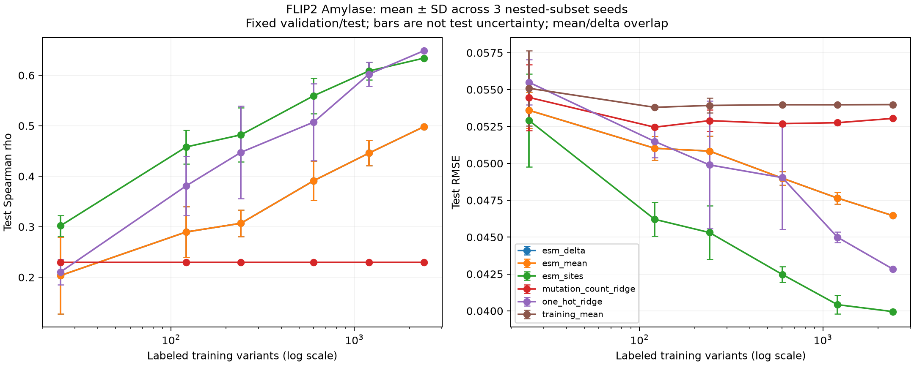

# ProteinMod

ProteinMod implements reproducible supervised activity prediction on **FLIP2 Alpha Amylase,
by-mutation**, a single-protein assay. It does **not** demonstrate cross-protein
or family generalization. M0 contains elementary baselines; M1 adds frozen ESM-2 features.

## Install and reproduce

Python **3.11–3.14** is supported; the measured run used Python 3.12.15 on Apple
silicon. From the repository root:

```sh
python3.12 -m venv .venv
source .venv/bin/activate
python -m pip install -e '.[dev]'
proteinmod download --config configs/amylase.toml
proteinmod validate --config configs/amylase.toml
proteinmod run --config configs/amylase.toml
ruff check .
pytest
```

For M0, only `download` accesses the network. M1 adds explicit model extraction below. `validate`, `run`, and tests work offline
once dependencies and data are present. CI uses synthetic fixtures, never downloads
the benchmark. For an existing exact official file:

```sh
proteinmod run --config configs/amylase.toml --data /absolute/path/by_mutation.csv.gz --output runs/local
```

The configured checksum is enforced for local files too. Paths in TOML are relative
to the working directory. `data/cache/`, virtual environments and `runs/` are ignored.
The download stores a source/checksum manifest beside the cached file. To reproduce
the recorded dependency versions, install `requirements-benchmark.txt` before the
editable package; these pins describe the Python 3.12 measured environment.

## Provenance and scientific controls

- Official [FLIP2 catalog](https://flip.protein.properties/), versioned
  [Zenodo record 18433203, v3](https://zenodo.org/records/18433203), and
  [Didi et al. (2026)](https://proceedings.mlr.press/v306/didi26a.html).
- Zenodo's amylase README attributes the assay to Van der Flier et al., *Enzyme
  structure correlates with variant effect predictability*, CSBJ 23 (2024),
  3489–3497, and links the [original MIT-licensed data](https://github.com/florisvdf/mutation-predictability/tree/main/data/AMY_BACSU).
- The config records the published compressed-file MD5. Every run records SHA256,
  complete config, reference provenance, package versions, Git revision/dirty state
  and elapsed time. The original assay `reference.fasta` is bound to Git blob
  `920b6c14b659029dd1f5497329dab98c0c8755e2`; its 425-residue sequence is embedded in
  the config. The blob check uses the exact original FASTA header `> 0` and newline.
  A custom reference requires source attribution plus a Git blob or sequence SHA256.
  A checksum binds bytes; the source must independently establish biological WT identity.
- Canonical uppercase residues, equal lengths, finite numeric targets, missing/duplicate
  IDs, duplicate sequences and assignments are checked. Official CSVs have no IDs:
  stable 1-based source row IDs are generated and explicitly identified in QC.
  Invalid inputs fail instead of silently being dropped or deduplicated.
- The official CSV has `set=train, validation=True` for 601 rows. These become the
  effective validation partition and are **excluded from fitting**. Test/validation
  overlap is rejected. No random split, resampling or test-label model selection occurs.
- QC reports lengths, effective counts, validation/raw-set overlap, sequence leakage,
  per-partition mutation burdens and pairwise unique-substitution overlap. The actual
  official distribution has **410 shared substitutions between effective train and
  test**, despite no shared full sequences. We preserve the official file and report
  this observation; do not interpret its name as strict substitution disjointness.
- Ridge uses fixed full-sequence 20-letter position features or a single mutation-count
  feature. No scaling is used. All candidates fit only training rows, choose minimum
  validation RMSE (tie: smallest alpha), and remain fit on training rows only. Seed 0,
  deterministic LSQR solver, tolerance 1e-8, at most 10,000 iterations. Test labels
  are used only for the final evaluation. Constant predictions have undefined
  correlations, serialized as JSON null rather than invented zeros.
- Removing `[reference]` permits mean and one-hot models while explicitly skipping
  mutation-count ridge and mutation annotations. An invalid supplied reference fails
  clearly. WT is never guessed from variant frequency.

## Actual M0 result

Measured on the official downloaded file on October 14, 2026: **3,706** variants,
length **425**; **2,403 train / 601 validation / 702 test**. No duplicate sequences
or IDs. Source SHA256:
`2e76acc9da3ef04a8ccecd8a3f631b84ee2e4e1f0cdea406f18153387b986d04`.

| Baseline | Test Spearman rho | Test Pearson r | MAE | RMSE |
|---|---:|---:|---:|---:|
| Training mean | undefined | undefined | 0.048968 | 0.053985 |
| Mutation-count ridge | 0.229543 | 0.237123 | 0.042635 | 0.053048 |
| Full-sequence one-hot ridge | 0.648837 | 0.683810 | 0.033651 | 0.042845 |

Selected alpha: **1** for one-hot, **10** for mutation count, chosen only on validation.
These are ProteinMod M0 scores, not a claim to replicate the paper's entire protocol.
Checked-in evidence lives in `benchmarks/amylase/`: `metrics.json`, `qc.json`,
`manifest.json`, `test_predictions.csv` and `report.md`. New runs generate the same
artifact set under `runs/amylase/`. Scores use the distributed target units directly.

## How to interpret the baseline

A held-out mutation split evaluates unseen variants/substitutions on the same protein;
positions can still be familiar. A held-out position split tests previously unperturbed
positions. A held-out protein split tests transfer to different protein backbones.
The overlap statistics above qualify what is actually held out in this distribution.

Given WT `ACDE` and variant `CCDF`, compare aligned residues: position 1 changes
A to C and position 4 changes E to F, giving the sorted set `A1C;E4F` and burden 2.
Length mismatches cannot be represented as substitutions and are rejected. Full-sequence
one-hot ridge learns regularized additive contributions of residue identity at each
position. It is a meaningful inexpensive control for learned representations, although
it cannot explicitly model epistasis or establish transfer to other proteins.

## M1: frozen ESM-2 (implemented)

Install the optional experiment dependencies and run from the repository root:

```sh
source .venv/bin/activate
python -m pip install -e '.[dev,esm]'
# Optional: install the exact measured Python 3.12 environment first:
# python -m pip install -r requirements-m1.txt
proteinmod download --config configs/amylase_m1.toml
HF_HUB_DISABLE_XET=1 proteinmod extract --config configs/amylase_m1.toml
MPLCONFIGDIR=/tmp/proteinmod-mpl XDG_CACHE_HOME=/tmp/proteinmod-cache OPENBLAS_NUM_THREADS=4 OMP_NUM_THREADS=4 proteinmod run-m1 --config configs/amylase_m1.toml
ruff check .
pytest
```

`extract` explicitly downloads the pinned checkpoint/tokenizer if absent; it is the
only M1 command requiring network access. Reuse existing files without network:

```sh
proteinmod extract --config configs/amylase_m1.toml --local-only
proteinmod run-m1 --config configs/amylase_m1.toml --output runs/amylase_m1_repeat
```

`run-m1` uses verified cached features and refuses to overwrite M0's historical
artifact directory. M0 config, code paths, historical scores and predictions are
preserved. All three M0 baselines reproduced **exactly (maximum prediction
difference 0)** in the matched M1 experiment. The same data checksum and 702 test
identities/targets are checked before accepting the comparison. Original 32 tests
continue to pass; CI runs offline mock encoders without Torch or model weights.

The [official ESM-2 35M checkpoint](https://huggingface.co/facebook/esm2_t12_35M_UR50D)
is MIT-licensed. Model and tokenizer are pinned to revision
`6fbf070e65b0b7291e7bbcd451118c216cff79d8`. Use the optional dependency pins in
`requirements-m1.txt` for the measured environment. The implementation uses frozen
eval mode, no gradient updates, float32 last-layer residue states, batches of 8,
explicit special/padding masks and residue-token checks; overlong sequences fail
instead of being truncated. Model/dataset downloads, regression and plotting are
separate steps. Caches bind dataset SHA, ordered sequences, WT, revision, settings
and extractor source hash; content checksums and shapes are verified on reuse.
Changing an extraction setting creates a new cache. A corrupt cache fails; remove
that cache directory and re-extract. Interrupted extraction is rerun from the start.

Set `embedding.device` in TOML to `cpu`, `mps`, `cuda` or `auto` (CUDA, then MPS,
then CPU). Unsupported devices fail clearly. Reduce batch size for limited memory;
there is no hidden fallback or truncation. This local run used **MPS**, Python
3.12.15, Torch 2.14.1, Transformers 4.57.6 and float32 inference. WT plus all 3,706
variants extracted in **224 seconds**, including initial checkpoint loading;
the local model cache is about **134 MiB** and compressed feature cache **26.3 MiB**.
Inference additionally needs batch-dependent activation memory; CPU is supported
but was not timed. Checkpoints and embeddings remain under ignored `data/cache/`.

Actual full-data results on October 14, 2026:

| Representation | Test Spearman rho | Test Pearson r | MAE | RMSE |
|---|---:|---:|---:|---:|
| M0 one-hot ridge | 0.648837 | 0.683810 | 0.033651 | 0.042845 |
| ESM mutant mean (480) | 0.498379 | 0.515328 | 0.040200 | 0.046462 |
| ESM mutant-minus-WT mean (480) | 0.498379 | 0.515328 | 0.040200 | 0.046462 |
| ESM mutation-site aggregate (961) | 0.634051 | 0.687888 | 0.031407 | 0.039956 |

Site features improve MAE/RMSE over one-hot, while one-hot retains higher Spearman.
Full-sequence mean pooling underperforms one-hot in this run. Do not interpret
pretraining as an unconditional improvement or these paired scores as significance tests.

Learning curves use **25, 121, 241, 601, 1,202 and 2,403** training labels with three
nested subset seeds (0/1/2). At 25 training labels, site features achieve Spearman
**0.301947 ± 0.020724** versus one-hot **0.210356 ± 0.025385**; RMSE is
**0.052909 ± 0.003142** versus **0.055495 ± 0.001535**. At 121 labels, site features
achieve Spearman **0.458044 ± 0.033698** versus **0.380898 ± 0.058901**.
These are mean ± sample SD across training subset seeds, **not test confidence
intervals**. Every model uses the same subsets and fixed validation/test partitions.
The 601 validation labels are still available at every training size: these are
low-training-label experiments, not 25-label total annotation budgets.



All six models and four metrics at every training size are recorded in
`benchmarks/amylase_m1/learning_curve_runs.json` and `learning_curve_summary.csv`.
The same directory contains full-data predictions, QC, model/cache/run provenance,
PNG/SVG plots and a report. New runs go to `runs/amylase_m1/`. The protocol is
in `docs/m1_protocol.md`; alphas and representation choices were fixed before
inspecting M1 test outcomes. Ridge still uses training rows only and validation
RMSE selection without feature scaling or validation refit.

A mutant mean summarizes the whole sequence. Its WT delta subtracts a constant
vector for this single-WT assay; with ridge's intercept they are mathematically
equivalent, as the measured results confirm within numerical precision. They can
differ for multiple WTs, models without an intercept, nonlinear heads, or different
preprocessing. Site features average mutant states and mutant-minus-WT states only
at substituted sites and append site count, with zeros for WT. Symmetric pooling
handles multi-site mutants without depending on mutation ordering and can retain
local effects that global pooling dilutes. Pretraining may supply useful biochemical
structure with few labels; it can also miss assay-specific signal.

Limits: one protein, **410 shared train/test substitutions**, only three subset
seeds, and unknown pretraining-corpus overlap. Extracting held-out sequence features
is **label-free transductive evaluation**, not cross-protein generalization.
M1 adds no GNN, structural integration, cross-attention, multitask head or fine-tuning.

## M2: audited residue-level structure context (implemented)

M2 adds explicit PDB/mmCIF acquisition, unique reference/chain alignment, mutation
mapping, Cα contact graphs, solvent accessibility and separate experimental/predicted
confidence semantics. It extracts **reference-structure context**, not mutant
rearrangements. No GNN, cross-attention or new fitness predictor is trained.

```sh
source .venv/bin/activate
python -m pip install -e '.[dev,structure]'
# Optional exact measured M2 dependencies, without Torch:
# python -m pip install -r requirements-m2.txt

# Explicit network acquisition; all later steps are offline.
proteinmod download --config configs/amylase.toml
proteinmod structure-download --config configs/amylase_m2.toml
proteinmod structure-download --config configs/amylase_m2_pdb.toml
proteinmod structure-download --config configs/ubiquitin_m2.toml
proteinmod structure-download --config configs/ubiquitin_m2_pdb.toml
proteinmod structure-download --config configs/amylase_m2_alphafold.toml

# One audited extraction, or all five real cases plus format/history checks:
MPLCONFIGDIR=/tmp/proteinmod-mpl XDG_CACHE_HOME=/tmp/proteinmod-cache proteinmod structure-run --config configs/amylase_m2.toml
MPLCONFIGDIR=/tmp/proteinmod-mpl XDG_CACHE_HOME=/tmp/proteinmod-cache python scripts/verify_structures.py
ruff check .
pytest
```

For an exact verified local copy, use `--data /absolute/path/1UA7.cif`; the pinned
SHA256 is still enforced. For another protein, supply a TOML with `structure.kind
= "local"`, file path/SHA/source/license/confidence semantics, a checksum-bound
reference, mapping thresholds/chain, geometry and output settings. Copy a provided
config as a template. Structures/download manifests stay under ignored `data/cache/`.
No import, ordinary test or structural extraction command downloads anything.

Actual local verification on October 14, 2026:

| Structural source | Reference Cα coverage | Aligned identity | Identity-compatible sites | Cα edges |
|---|---:|---:|---:|---:|
| Experimental 1UA7, PDB and mmCIF | 422/425 (99.29%) | 98.34% | 415 | 2,195 |
| Experimental ubiquitin 1UBQ, PDB and mmCIF | 76/76 (100%) | 100% | 76 | 326 |
| Predicted AF-P00691-F1 v6, mmCIF | 425/425 (100%) | 99.06% | 421 | 2,235 |

For both experimental proteins, author/reference mapping, Cα coordinates, RSA and
all contact edge records agree between PDB and mmCIF: **maximum coordinate and RSA
differences are 0**. All **19 historical M0/M1 artifact files** remained hash-identical.
Five real structural extractions completed; no fitness improvement score is claimed.

The assay-linked [1UA7 structure](https://www.rcsb.org/structure/1UA7) was identified
through the original assay repository, not guessed by protein name. It lacks assay
positions 1–3 and differs at `S105F;P126Q;S142L;D163E;V214A;V254S;N356Q`. Unreviewed
mapping is rejected; the checked-in config explicitly approves these differences
for related-construct context. Mutation sites on mismatches still produce null
features. The predicted native P00691 model likewise differs at four sites and is
an explicitly labeled alternative context, not the exact assay WT. Its aligned
span has mean pLDDT **97.274**, range **78.81–99.00**; this says nothing about mutant
stability or inter-domain accuracy. Ubiquitin uses its traceable deposited entity
reference, not a fabricated second mutation assay.

SASA uses Shrake–Rupley, probe 1.4 Å, 960 sphere points/atom and Tien 2013 theoretical
maxima for RSA. RSA is unclipped and values above 1 are flagged. Heavy ligands and
other chains in the selected model can occlude surface; waters/H/D and crystal
symmetry copies are excluded. Graph nodes are mapped reference Cα atoms; spatial
contacts use ≤8 Å, with separately verified backbone links and nonlocal contact
counts. Density is contact count divided by sphere volume. Missing loops are not
interpolated; alternate conformers, author numbering/insertion codes, noncanonical
parents, missing atoms and construct differences are audited.

Experimental Cα B-factors remain **Ų**, separate from **0–100 AlphaFold pLDDT**.
B-factor magnitude is never converted into pLDDT or given its thresholds. Low pLDDT
can reflect flexibility/disorder or insufficient information; it is not measured
stability. DSSP is optional (`auto`, `required` or `off`): it was **unavailable** for
these runs, so secondary structure is explicitly null. No SS assignments are invented.

Per-variant outputs include validated mutation identity, author mapping, sequence
versus spatial neighborhoods, symmetric mutation-site distances, confidence and
site aggregates with explicit missing counts. Nine amylase examples include WT,
synthetic diagnostics and the first five actual FLIP2 variants; synthetic examples
have no fitness labels. Geometry always comes from the reference structure.

Reproducible evidence lives in `benchmarks/structures/`: mapping audits, residue and
variant CSV/JSON, contacts, PNG/SVG views, checksums/manifests and a summary report.
Re-runs go to ignored `runs/m2_verification/`. See [the M2 protocol](docs/m2_protocol.md)
for alignment scoring, missingness, confidence interpretation, licenses, sources
and limitations. Source code is modular across acquisition, mapping and geometry;
original M0/M1 data/model/experiment modules and artifacts are preserved.

## Roadmap (not implemented)

Sequence PLM/structural GNN fusion with bidirectional cross-attention; stability/function
heads; advanced multi-mutation modeling; progressive protein/family-held-out evaluation.
M0 already annotates multiple substitutions but implements only elementary supervised
baselines. Data validation, features, fitting and artifact output are separate modules
under `src/proteinmod` so later features can be added without changing split handling.

## M3: structural ridge and compact residue GNN

M3 compares mutation-centered structural ridge, a two-layer residue GNN and a zero-message-passing neural control against M0 one-hot and M1 frozen ESM-2 mutation-site ridge. All are refitted on identical structurally valid training subsets and evaluated on the same held-out variants, with validation-only selection. M0/M1/M2 configurations and historical evidence remain unchanged.

```sh
python -m pip install -e '.[dev,m3,esm]' -r requirements-m3.txt
proteinmod run-m3 --config configs/amylase_m3.toml --baseline-only --output runs/m3_baseline
proteinmod run-m3 --config configs/amylase_m3.toml
python scripts/report_m3.py --output runs/amylase_m3
```

Requires the original pinned dataset and frozen ESM cache (see M1 extraction instructions above); committed validated M2 graph artifacts supply reference geometry. No new structure/model downloads occur during training. Execution uses deterministic CPU operations on Apple Silicon. A real MPS smoke test encountered nondeterministic index aggregation, so this milestone explicitly requires CPU.

See [M3 protocol](docs/m3_protocol.md) for features, architecture, filtering, leakage controls and exact reproduction. Verified numerical results, predictions, fit gaps and failure slices are under [M3 benchmark evidence](benchmarks/amylase_m3/report.md). Geometry describes the reference construct, not mutant rearrangements. This single-protein experiment makes no cross-protein claim. No cross-attention, fusion, multitask learning or LM fine-tuning is included.

Actual M3 full-training results on the **same 700 test variants** (2,296 train / 577 validation; mean over three seeds):

| Model | Test Spearman rho | Test RMSE |
|---|---:|---:|
| M0 one-hot ridge | 0.64516 | 0.04289 |
| M1 ESM mutation-site ridge | 0.62444 | 0.04045 |
| M3 structural ridge | 0.63127 | 0.03857 |
| M3 zero-layer neural control | 0.64313 ± 0.01221 | 0.03710 ± 0.00088 |
| M3 two-layer GNN | 0.65489 ± 0.02355 | 0.03649 ± 0.00121 |

The GNN's mean gain over the zero-layer control is smaller than its seed spread and costs about 138 seconds per full-data grid fit versus 9 seconds for the control and 0.30 seconds for structural ridge. At 10% training data, structural ridge beats the GNN (RMSE 0.04340 versus 0.04616). The GNN also underperforms the control on the 50 test variants with six or more mutations. These limitations are retained in the report; no architecture was retuned on test results. The final local experiment took 538 seconds and about 435 MiB peak process memory. All 78 historical artifacts were verified unchanged.

## M4: cross-protein generalization pilot

M4 adds a bounded, three-assay FLIP2 collection: Alpha Amylase activity, GB1 binding and NucB ordinal activity. G1 retains within-protein variant partitions; G2 holds out entire proteins, with distinct source-training, validation and test proteins. Assay-local training midrank targets and per-protein Spearman avoid pooling unlike experimental scales. Sequence-only and structure-matched cohorts are reported separately.

```sh
proteinmod download-m4 --config configs/m4.json
proteinmod prepare-m4 --config configs/m4.json --local-only
proteinmod run-m4 --config configs/m4.json
python scripts/report_m4.py --output runs/m4
```

Requires the original M1 amylase embedding cache and the pinned frozen ESM checkpoint; fresh-machine commands, licenses, domain crops, leakage controls and limitations are in [the M4 protocol](docs/m4_protocol.md). No ProteinGym-wide download is needed. Each assay contributes at most 600 variants selected without labels. The shared structural GNN uses the M2/M3 graph definitions and one scalar head; no cross-attention, fusion, LoRA or multitask heads are added.

Verified predictions, per-protein and macro scores, cohort exclusions and plots are in [M4 benchmark evidence](benchmarks/m4/report.md). Family annotations and sequence-alignment audits do **not** establish unseen-family generalization. M0–M3 historical artifacts remain unchanged.

Actual M4 results (equal-protein macro Spearman, **structure-matched cohort**, two GNN seeds):

| Model | G1 known proteins | G2 held-out proteins |
|---|---:|---:|
| Mutation-count ridge | 0.1663 | 0.1965 |
| Transferable sequence ridge | 0.3938 | 0.1428 |
| Frozen ESM mutation-site probe | 0.4932 | 0.1258 |
| Structural ridge | 0.4612 | 0.1669 |
| Structural GNN | 0.4704 ± 0.0227 | 0.1300 ± 0.0010 |

G1 evaluates original held-out variants; primary G2 evaluates all selected variants of a held-out protein. The report additionally evaluates G2 on exactly the G1 test IDs, preserving the transfer drop (ESM 0.4932→0.1182; GNN 0.4704→0.1497). G1-only per-protein one-hot ridge reaches 0.6254; its position-specific coefficients are not transferred across unaligned proteins.

Transfer is weak and does not establish a structural-model advantage. NucB G2 correlations are near zero or negative; protein and assay-endpoint shifts are confounded. The repeated local experiment took about 60 seconds and reproduced all 18,700 predictions exactly; all 103 historical M0–M3 files remained unchanged. See the report for per-protein scores, explicit exclusions, seed variation, computational costs and limitations.

### M5: hybrid sequence–structure pilot (stacked on M4)

M5 compares frozen ESM-2 residue tokens and the existing structural GNN using weighted fusion, concatenation, either cross-attention direction and bidirectional attention, with neural single-modality controls. It reuses the exact M4 matched G1/G2 role IDs and training-only assay targets. See [the protocol](docs/m5_protocol.md) for architecture, masks, reproducible local commands and scope. Results and limitations are recorded in `benchmarks/m5/report.md`; historical M0–M4 artifacts are retained.

### M6: experimental stability prediction

M6 adds an independent, continuous ΔΔG head over the frozen M5 sequence–structure encoder, with real experimental folding-stability labels. It preserves kcal/mol units and explicit sign conversion, verifies mutation coordinates, and evaluates protein-held-out predictions against stability baselines. See [the data and evaluation protocol](docs/m6_protocol.md) and [the benchmark report](benchmarks/m6/report.md). Function and stability objectives are trained separately; no multitask or stability-informed function prediction is included.

## M7 progressive stability–function multitask learning

M7 compares independent task training with a shared bidirectional sequence–structure
representation and separate function/stability heads. ESM-2 stays frozen. Unpaired
examples carry explicit observed-task masks; absent labels never enter arithmetic.
Two head-only epochs precede shared GNN/attention updates. Native stability predictions
remain folding ΔΔG in kcal/mol, positive destabilization; function evaluation retains
per-assay training-only ranks and native-measurement Spearman.

The exact M5 G1/G2 and M6 S1/S2 IDs are retained. Three fixed seeds compare independent,
shared-frozen, equal-weight joint and validation-selected joint models. All new pathways
start from matched fresh initialization to avoid leaking function labels through M6's
fixed pretrained checkpoint. See [M7 protocol](docs/m7_protocol.md) for fold pairing,
validation criteria, masked losses, compute controls and dataset limitations.

```sh
python -m proteinmod.multitask_experiments --config configs/m7.json
python scripts/replay_m7_references.py
python scripts/verify_m7.py
python scripts/report_m7.py --input runs/m7 --output runs/m7
ruff check .
ruff format --check .
pytest -q
```

Use the M4/M5/M6 preparation instructions first; M7 reuses their checksum-validated
frozen residue caches and structures. Large arrays/checkpoints remain ignored. M7
results and scientific interpretation are archived under `benchmarks/m7/`.
No paired observations or mechanistic stability–function link are inferred from shared
training. Stability-conditioned function prediction remains outside M7.

Actual M7 held-out-protein means over three seeds:

| Model | Function macro Spearman ↑ | Stability macro RMSE kcal/mol ↓ |
|---|---:|---:|
| Independent | .102592 | 1.247250 |
| Equal joint | .098700 | 1.250014 |
| Validation-selected joint | .078303 | 1.218225 |

Mean changes are smaller than seed variation; there is no consistent multitask benefit.
All 72 fits and 73,134 predictions are retained in [results](benchmarks/m7/report.md),
with [failure analysis](benchmarks/m7/interpretation.md) and per-protein negative transfer.
The CPU run took 506.79 seconds. Both historical reference replays and a repeated M7
held-out fit matched exactly; all 156 historical benchmark files remain unchanged.

## M8 stability-informed functional prediction

M8 uses experimentally trained M6 ESM-site/structural ridge predictions to condition
functional models on the exact M7 G1/G2 cohorts. It compares scalar-only regression,
feature ridge, additive correction of a fixed M7 model, and new heads over frozen M7
multimodal representations. Shuffled predictions and matched-scale dummy scalars
control for nuisance information and extra capacity. No paired stability labels are
invented; every function-protein stability value is an unverified OOD prediction.

Actual G2 macro Spearman, three seeds:

| Model | Matched independent baseline | ESM-conditioned | Structure-conditioned |
|---|---:|---:|---:|
| Feature ridge | .191013 | .196131 | .192179 |
| M7 + residual correction | .102592 | .122329 | .166501 |
| New frozen-representation head | .092811 | .099704 | .118238 |

The structural stability source has catastrophic absolute extrapolation caused by
nearly constant descriptor scaling; its outputs cannot be interpreted as usable
thermodynamic estimates. Gains are source/protein-dependent, and neural dummy controls
explain some gains. See [results](benchmarks/m8/report.md),
[failure analysis](benchmarks/m8/interpretation.md) and [protocol](docs/m8_protocol.md).

```sh
python -m proteinmod.conditioning_experiments --config configs/m8.json
MPLCONFIGDIR=/tmp/proteinmod-m8-matplotlib python scripts/report_m8.py --input runs/m8 --output runs/m8
ruff check .
ruff format --check .
pytest -q
```

All 176 M0–M7 evidence files remain unchanged. The corrected 312-fit local run took
35.01 seconds; a full repeat reproduces all 161,433 held-out predictions exactly.
M9 remains outside this milestone.

## M9 assay-aware mutation-effect prediction

M9 crosses three new proteins (PTEN, CYP2C9, VKOR1) with abundance and activity
assays: 540 shared genotypes, 1,080 measured observations. Paired endpoints stay
together in G1; G2 holds out entire proteins with both endpoint families known
in training. Metadata carries endpoint, technology, biological context, substrate,
units/direction and explicit condition missingness. Train-only vocabulary/scaling,
unknown-category handling and identical-capacity controls prevent label/protein
identity shortcuts. No M8 stability scalar is used.

Actual equal-protein macro Spearman:

| Model | G1 | G2 |
|---|---:|---:|
| ESM mutation-site ridge | .3545 | .2810 |
| Structural ridge | .3352 | .2650 |
| Unconditioned neural head | .3050 | .2278 |
| Structured metadata head | .2772 | .2008 |
| Shuffled training metadata | .2775 | .2810 |

This is a negative conditioning result. Frozen multimodal features shift strongly
between proteins; bounded ridge predictions collapse in all three G2 folds, and
conditioned neural predictions saturate on CYP2C9. Temperature/pH are unavailable
in the curated records, so numeric condition effects remain untested. Activity
proxies differ, assay IDs still identify proteins, and unseen-assay/family transfer
is not established. The new cohort is not directly comparable to M4/M8 metrics.

See [results and failures](benchmarks/m9/REPORT.md), [protocol](docs/m9_protocol.md)
and [configuration](configs/m9.json). Reproduction after frozen M7 encoder setup:

```sh
python -m proteinmod.assay_experiments download --config configs/m9.json
python -m proteinmod.assay_experiments prepare --config configs/m9.json
python -m proteinmod.assay_experiments run --config configs/m9.json
python scripts/verify_m9.py --input runs/m9
python scripts/audit_m9.py --input runs/m9
MPLCONFIGDIR=/tmp/proteinmod-m9-matplotlib python scripts/report_m9.py --input runs/m9 --output runs/m9
```

All 199 M0–M8 evidence files remain unchanged. The full repeated experiment produces
identical predictions and metrics; all 60 saved heads replay exactly. Work is stacked
on draft PR #16 → #14 → #12, leaving main unchanged. M10 is outside this milestone.

## M10 confidence-aware sequence–structure fusion

M10 distinguishes AlphaFold pLDDT (reference geometry confidence), experimental
B-factors (Ų), resolution (Å), mapping coverage and missingness. It enables typed
confidence in the existing frozen GNN input and adds a learned reliability gate over
bidirectional sequence-query/structure-query experts. Missing structures mask all
structural attention and force the structural mixing weight to zero. Gate weights
are neither calibrated predictive uncertainty nor causal biological explanations.

Actual results on the **unchanged M9 G1/G2 six-assay cohort**, three seeds:

| Model | G1 macro Spearman | G2 macro Spearman |
|---|---:|---:|
| Neutral-confidence, unconditioned head | .3171 | .3491 |
| Confidence input | .2420 | .3090 |
| Weighted late fusion | .2977 | .3443 |
| Learned reliability gate | .2725 | .3365 |
| Confidence input + gate | .2354 | .3082 |
| Zero-confidence gate control | .2856 | .3381 |
| Shuffled input + gate | .2506 | .3048 |

Confidence did not improve this pilot. Low/high pLDDT slices differ, and the small
combined-minus-shuffled gain changes sign across seeds. All structures are AlphaFold;
experimental-source performance and calibrated uncertainty remain untested. Encoder
weights stay frozen; all new heads use the same raw feature scale, so historical M9
head scores are not a matched architecture comparison.

```sh
python -m proteinmod.reliability_experiments prepare --config configs/m10.json
python -m proteinmod.reliability_experiments run --config configs/m10.json
python scripts/verify_m10.py --input runs/m10
MPLCONFIGDIR=/tmp/proteinmod-m10-matplotlib python scripts/report_m10.py --input runs/m10 --output runs/m10
```

Use existing M9/M7 frozen caches first; see the [protocol](docs/m10_protocol.md),
[results/failure analysis](benchmarks/m10/REPORT.md), [quality slices](benchmarks/m10/quality_slices.csv)
and [gate diagnostics](benchmarks/m10/gates.csv). The 96 fits produce29,808 matched
held-out predictions and the same number of missing-structure stress predictions.
A full repeat is exact; all saved predictions/gates/fallbacks replay exactly. All219
M0–M9 evidence files and old configurations remain unchanged. No M8 OOD stability
values are used. Work is stacked on #18 → #16 → #14 → #12; no M11 implementation.

## M11 explicit mutation interactions and measured epistasis

M11 uses the original measured four-site GB1 landscape with all76 singles and2,091
doubles, plus a label-blind360 triples/120 quadruples. It derives **every label from
the same experiment's input/selected counts**, avoiding the published single-fitness
column imported/rescaled from another study. WT-normalized log enrichment uses an
explicit0.01 observation floor; direct epistasis requires four uncensored measured
factorial constituents. No missing measurement is invented.

C1 holds out complete combinations; C2 excludes position pair39–54 from all training
and validation backgrounds. Actual held-out log-fitness RMSE:

| Model | C1 | C2 |
|---|---:|---:|
| Measured-single additive | 1.9853 | 2.6643 |
| Frozen ESM probe | .8228 | 1.2263 |
| Sequence pair residual ridge | 1.3719 | 1.7808 |
| Structural pair residual ridge | 1.3327 | 2.5846 |
| Learned hybrid pair residual | 1.0655 | 2.4696 |
| Matched hybrid without explicit3D | 1.0641 | 2.2086 |

The explicit hybrid improves C1 WT-background epistasis MAE from1.0340 to.7658,
but worsens C2 MAE from1.2286 to1.3520. Real3D does not beat zero/shuffled controls;
non-WT background contrasts and increasing mutation burden expose further failures.
Fitness ranking alone does not prove epistasis recovery. All explicit pair features
and learned sums are symmetric; they do not estimate true higher-order coefficients.

```sh
python -m proteinmod.epistasis_experiments download --config configs/m11.json
python -m proteinmod.epistasis_experiments prepare --config configs/m11.json
python -m proteinmod.epistasis_experiments run --config configs/m11.json
python scripts/verify_m11.py --input runs/m11
MPLCONFIGDIR=/tmp/proteinmod-m11-matplotlib python scripts/report_m11.py --input runs/m11 --output runs/m11
```

See [protocol](docs/m11_protocol.md), [results/failure analysis](benchmarks/m11/REPORT.md),
[model-implied factorial predictions](benchmarks/m11/epistasis_predictions.csv)
and [conditional paired-block intervals](benchmarks/m11/paired_bootstrap.json).
The54 model/seed/protocol cases yield28,080 fitness predictions and19,656 factorial
predictions. Full repeat and saved-model replay are exact. All238 M0–M10 artifacts
and15 prior configurations remain unchanged. M11 is stacked on #20; main unchanged.
No M12 expansion, new encoder training or calibrated predictive uncertainty.

### M12: family-held-out domain benchmark

M12 adds G1/G2/G3 evaluation for eight experimentally measured domains in four
externally annotated Pfam families. It trains fresh sequence/ESM, structural ridge/GNN,
weighted fusion and bidirectional-attention models with family-disjoint G3 roles.
The fixed local experiment found G3 family-macro Spearman **0.430** for structural
ridge, **0.401** for frozen ESM-2, **0.397** for the GNN and **0.350** for bidirectional
attention. This bounded stability mutation-effect benchmark does not establish broad
functional or unseen-fold generalization. See [verified results](benchmarks/m12/REPORT.md),
[provenance](benchmarks/m12/DATA_PROVENANCE.md), [preregistration](benchmarks/m12/PREREGISTRATION.md)
and [reproduction and limitations](docs/M12.md). M0–M11 artifacts remain unchanged.
