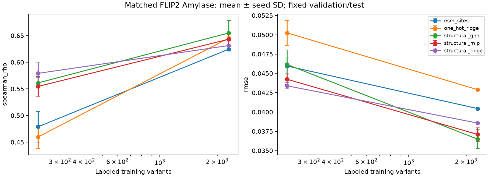

# M3: matched structural prediction results

Actual local experiments; full results are means ± sample SD over seeds 0/1/2.
Seed SD is training variation, not uncertainty over future proteins.

Original counts: {'train': 2403, 'validation': 601, 'test': 702}; valid: {'train': 2296, 'validation': 577, 'test': 700}; excluded: {'train': 107, 'validation': 24, 'test': 2}.
Exclusion site reasons (a variant can have several): {'sequence_mismatch': 161}.
All models were refitted on identical valid training subsets; official split membership is unchanged.

| Model | Spearman rho | Pearson r | MAE | RMSE |
|---|---:|---:|---:|---:|
| esm_sites | 0.624444 ± 0.000000 | 0.679105 ± 0.000000 | 0.031887 ± 0.000000 | 0.040449 ± 0.000000 |
| one_hot_ridge | 0.645156 ± 0.000000 | 0.682693 ± 0.000000 | 0.033626 ± 0.000000 | 0.042894 ± 0.000000 |
| structural_gnn | 0.654893 ± 0.023552 | 0.744947 ± 0.024442 | 0.022651 ± 0.001563 | 0.036490 ± 0.001215 |
| structural_mlp | 0.643132 ± 0.012212 | 0.727387 ± 0.013924 | 0.025040 ± 0.001009 | 0.037097 ± 0.000880 |
| structural_ridge | 0.631275 ± 0.000000 | 0.697370 ± 0.000000 | 0.029700 ± 0.000000 | 0.038571 ± 0.000000 |

## Learning curves

| Model | Fraction | Train n | Spearman rho | RMSE |
|---|---:|---:|---:|---:|
| esm_sites | 0.1 | 230 | 0.478827 ± 0.029057 | 0.045956 ± 0.001032 |
| esm_sites | 1.0 | 2296 | 0.624444 ± 0.000000 | 0.040449 ± 0.000000 |
| one_hot_ridge | 0.1 | 230 | 0.459754 ± 0.021708 | 0.050247 ± 0.001605 |
| one_hot_ridge | 1.0 | 2296 | 0.645156 ± 0.000000 | 0.042894 ± 0.000000 |
| structural_gnn | 0.1 | 230 | 0.561213 ± 0.009505 | 0.046158 ± 0.001880 |
| structural_gnn | 1.0 | 2296 | 0.654893 ± 0.023552 | 0.036490 ± 0.001215 |
| structural_mlp | 0.1 | 230 | 0.554614 ± 0.018352 | 0.044246 ± 0.000706 |
| structural_mlp | 1.0 | 2296 | 0.643132 ± 0.012212 | 0.037097 ± 0.000880 |
| structural_ridge | 0.1 | 230 | 0.579112 ± 0.019874 | 0.043396 ± 0.000400 |
| structural_ridge | 1.0 | 2296 | 0.631275 ± 0.000000 | 0.038571 ± 0.000000 |

## Failure analysis and fit gaps

| Model | Seed | Train RMSE | Validation RMSE | Test RMSE | Selected epoch |
|---|---:|---:|---:|---:|---:|
| one_hot_ridge | 0 | 0.024899 | 0.039581 | 0.042894 | — |
| esm_sites | 0 | 0.028202 | 0.037169 | 0.040449 | — |
| structural_ridge | 0 | 0.038044 | 0.039300 | 0.038571 | — |
| one_hot_ridge | 1 | 0.024899 | 0.039581 | 0.042894 | — |
| esm_sites | 1 | 0.028202 | 0.037169 | 0.040449 | — |
| structural_ridge | 1 | 0.038044 | 0.039300 | 0.038571 | — |
| one_hot_ridge | 2 | 0.024899 | 0.039581 | 0.042894 | — |
| esm_sites | 2 | 0.028202 | 0.037169 | 0.040449 | — |
| structural_ridge | 2 | 0.038044 | 0.039300 | 0.038571 | — |
| structural_mlp | 0 | 0.030075 | 0.035126 | 0.036930 | 37 |
| structural_gnn | 0 | 0.020947 | 0.029681 | 0.035703 | 79 |
| structural_mlp | 1 | 0.029200 | 0.033923 | 0.036313 | 32 |
| structural_gnn | 1 | 0.024323 | 0.030182 | 0.035878 | 37 |
| structural_mlp | 2 | 0.029501 | 0.034561 | 0.038048 | 39 |
| structural_gnn | 2 | 0.025921 | 0.031677 | 0.037889 | 29 |

Two-layer GNN minus zero-layer control RMSE: -0.000607 (negative favors message passing).
The mean message-passing gain must be read alongside the seed SD; three initializations do not establish statistical significance or generalization to other proteins.
The zero-layer control already sees RSA, contacts, residue chemistry and mutation identity; this ablation tests learned propagation.
Same-seed repeated GNN run: {'seed': 0, 'fraction': 0.1, 'max_prediction_difference': 0.0, 'repeat_seconds': 18.88918950012885}.

Largest individual residuals are retained in largest_errors.json; mutation-burden slice metrics are in error_slices.csv.
The test subset has the official mutation-burden distribution, which differs from training; ranking and squared-error metrics can disagree.
Training/validation gaps and seed spread limit conclusions about overfitting. Validation stopping controls selection but does not prove generalization.
This compact network has limited propagation range and receives reference-construct geometry, not true mutant conformational changes.
All results, including low-data and high-mutation-burden failures, are retained without test-driven architecture changes. No model is promoted based on one assay.

## Mapping, confidence and leakage

Graph: 415 nodes, 2137 edges, 1 component(s), 0 isolated nodes.
Missing descriptor counts: {'rsa': 0, 'contact_degree': 0, 'nonlocal_contact_degree': 0, 'bfactor_a2': 0, 'plddt': 415}.
Experimental B-factors are not pLDDT; all missing pLDDT values have explicit masks. DSSP secondary structure was unavailable and is omitted.
Complete duplicate sequences: 0; shared train/test substitutions: 408.
This is same-protein interpolation. Shared substitutions and reference graph context prevent claims of novel-site/cross-protein generalization.
Eligibility/features are label-free. Scaling and target normalization fit training only; validation RMSE selects alpha/epoch/weight decay; test labels do not enter selection.
See audit.json for all exclusions, source hashes, historical checksums and actual valid IDs.

## Compute

Device: cpu; CPU threads: 4; total wall time: 538.006 seconds.
Peak process RSS bytes: 455589888.
Historical files verified unchanged: 78.
Per-run tuning/training/prediction durations and parameter counts are in costs_and_fit_gaps.csv. Feature extraction uses cached M2/ESM artifacts; it is not included as new encoder compute.
Weights and dense feature arrays remain in the ignored cache; predictions, traces, hashes and numerical evidence are committed.

Reproduce with docs/m3_protocol.md and the exact config/environment recorded in manifest.json.

## Mutation-burden slices (mean RMSE over seeds)

| Model | Burden | Test n | RMSE |
|---|---|---:|---:|
| esm_sites | single | 35 | 0.055871 |
| esm_sites | 2_to_5 | 615 | 0.039328 |
| esm_sites | 6_plus | 50 | 0.041185 |
| one_hot_ridge | single | 35 | 0.047901 |
| one_hot_ridge | 2_to_5 | 615 | 0.041497 |
| one_hot_ridge | 6_plus | 50 | 0.054521 |
| structural_gnn | single | 35 | 0.038886 |
| structural_gnn | 2_to_5 | 615 | 0.036014 |
| structural_gnn | 6_plus | 50 | 0.040174 |
| structural_mlp | single | 35 | 0.037581 |
| structural_mlp | 2_to_5 | 615 | 0.037454 |
| structural_mlp | 6_plus | 50 | 0.031838 |
| structural_ridge | single | 35 | 0.044578 |
| structural_ridge | 2_to_5 | 615 | 0.038269 |
| structural_ridge | 6_plus | 50 | 0.037728 |

Only 35 single mutants and 50 variants with ≥6 mutations are held out; small slice sizes limit interpretation.
The low-data GNN trails structural ridge, and its ≥6-mutation RMSE exceeds the zero-layer control. Limited labels, propagation range and reference/mutant geometry differences are plausible limitations, not established causal explanations.

## Full-data compute (mean per seed, including hyperparameter selection)

| Model | Seconds | Neural parameters |
|---|---:|---:|
| esm_sites | 2.246 | — |
| one_hot_ridge | 1.671 | — |
| structural_gnn | 138.255 | 3473 |
| structural_mlp | 9.369 | 1777 |
| structural_ridge | 0.299 | — |

Historical M1 encoder extraction took 224.123 seconds on MPS, separate from these cached-feature probe fits. The final experiment duration excludes development runs, tests and the failed MPS smoke test.
The deterministic MPS smoke test failed on index aggregation; M3 therefore requires CPU. See local_verification.json for the recorded failure and full-dataset mutation-order checks.
