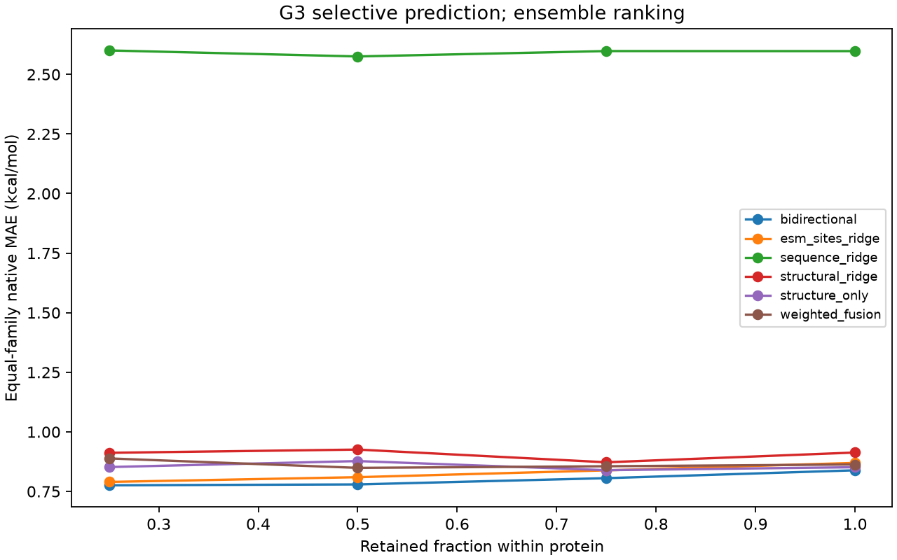

# M13 predictive uncertainty and calibration audit

Actual local fits on unchanged M12 test genotypes. Original assay-local DMS labels and M0–M12 evidence remain untouched. Native intervals use only 347 verified primary-table single-mutant labels, with explicit positive-destabilizing folding ΔΔG in kcal/mol. No rank output or unrelated assay score is silently called a thermodynamic measurement.

Execution: 1764 individual fits, 180 uncertainty evaluations and 32388 saved held-out predictions. Final-run wall time before reporting: 109.09 s; CPU process peak RSS 732,708,864 bytes. The separate preliminary control run is retained in control_audit.json; these costs are not one combined run. Frozen ESM features were reused from existing caches.

## Independent calibration under family shift

G1 reserves 12 native-eligible training variants/protein. G2 reserves two complete non-test proteins. G3 trains, validates, calibrates and tests on four distinct families. **Only one family calibrates each G3 fold.** Finite variant-residual intervals below are empirical diagnostics under shift; they do not guarantee coverage on unseen families. Correct finite-sample family-block quantiles are unbounded at both 80% and 90%, not estimates based on hundreds of supposedly independent families.

Native labels come from the existing M6 primary Figure 3 data release, crosswalked by pinned reference, substitution and complete mutant sequence. The processed M12 DMS labels and primary-table estimates can differ. These are not independent experimental replicates and are never used to estimate aleatoric variance. All native affine heads fit only training labels; calibration labels enter residual quantiles only.

## Native 90% interval results

Equal proteins within each M12 family, then equal families; two uncertainty replicates averaged. Widths are kcal/mol. M6 controls are a separate compatible native task and average proteins. Native test counts differ from rank-cohort counts because doubles/censored/missing primary labels are ineligible.

| Model | G1 coverage / width | G2 coverage / width | G3 coverage / width | G3 ensemble-scaled coverage / width |
|---|---:|---:|---:|---:|
| bidirectional | 0.898 / 3.324 | 0.898 / 3.106 | 0.869 / 3.650 | 0.887 / 6.501 |
| esm_sites_ridge | 0.907 / 3.200 | 0.889 / 3.070 | 0.885 / 3.584 | 0.898 / 3.923 |
| sequence_ridge | 0.928 / 3.808 | 0.889 / 3.860 | 0.703 / 6.229 | 0.694 / 7.587 |
| structural_ridge | 0.922 / 3.449 | 0.879 / 3.343 | 0.886 / 4.110 | 0.862 / 3.947 |
| structure_only | 0.914 / 3.571 | 0.887 / 3.478 | 0.820 / 3.513 | 0.908 / 6.279 |
| weighted_fusion | 0.906 / 3.409 | 0.900 / 3.045 | 0.851 / 3.578 | 0.864 / 5.587 |

## G3 per-family 90% residual coverage

| Model | PF00018 | PF00385 | PF00046 | PF00397 | Replicate SD of macro coverage |
|---|---:|---:|---:|---:|---:|
| bidirectional | 0.697 | 0.826 | 0.980 | 0.974 | 0.003 |
| esm_sites_ridge | 0.710 | 0.923 | 0.971 | 0.936 | 0.002 |
| sequence_ridge | 0.130 | 0.754 | 0.970 | 0.955 | 0.029 |
| structural_ridge | 0.704 | 0.870 | 0.995 | 0.974 | 0.010 |
| structure_only | 0.563 | 0.756 | 0.985 | 0.974 | 0.016 |
| weighted_fusion | 0.672 | 0.787 | 0.957 | 0.987 | 0.006 |

## G3 controls and uncertainty ranking

| Model | Gaussian coverage | Distance-scaled coverage | Shuffled-scaled coverage | SD–absolute-error ρ | Distance–error ρ | Shuffled–error ρ |
|---|---:|---:|---:|---:|---:|---:|
| bidirectional | 0.336 | 0.874 | 0.880 | 0.101 | 0.203 | -0.019 |
| esm_sites_ridge | 0.386 | 0.885 | 0.902 | 0.093 | 0.196 | 0.047 |
| sequence_ridge | 0.678 | 0.718 | 0.683 | -0.027 | 0.103 | 0.025 |
| structural_ridge | 0.398 | 0.883 | 0.885 | 0.026 | 0.071 | -0.014 |
| structure_only | 0.349 | 0.845 | 0.889 | -0.003 | 0.125 | -0.004 |
| weighted_fusion | 0.293 | 0.858 | 0.877 | 0.018 | 0.179 | -0.060 |

## G3 selective native risk

Mean absolute error (kcal/mol); lower is better. Retention is performed independently within each protein, then equally aggregated across proteins/families. Constant ranking breaks ties with a prespecified ID hash. These are descriptive curves, not statistical evidence from independent mutations.

| Model | Full MAE | Ensemble 25% MAE | Distance 25% MAE | Shuffled 25% MAE | Constant 25% MAE |
|---|---:|---:|---:|---:|---:|
| bidirectional | 0.839 | 0.776 | 0.762 | 0.803 | 0.838 |
| esm_sites_ridge | 0.870 | 0.790 | 0.802 | 0.829 | 0.774 |
| sequence_ridge | 2.598 | 2.600 | 2.557 | 2.598 | 2.518 |
| structural_ridge | 0.913 | 0.912 | 0.989 | 0.914 | 0.851 |
| structure_only | 0.852 | 0.852 | 0.844 | 0.846 | 0.831 |
| weighted_fusion | 0.863 | 0.889 | 0.801 | 0.878 | 0.867 |

## Native coverage at nominal 80% on G3

| Model | Residual coverage / width | Ensemble-scaled coverage / width |
|---|---:|---:|
| bidirectional | 0.793 / 2.868 | 0.783 / 4.164 |
| esm_sites_ridge | 0.803 / 2.866 | 0.805 / 3.068 |
| sequence_ridge | 0.648 / 5.411 | 0.653 / 6.240 |
| structural_ridge | 0.801 / 3.087 | 0.773 / 3.033 |
| structure_only | 0.757 / 2.817 | 0.792 / 3.786 |
| weighted_fusion | 0.783 / 2.941 | 0.754 / 3.565 |

## M6 native-unit sanity control

| Model | S1 90% coverage / width | S2 90% coverage / width |
|---|---:|---:|
| physicochemical_ridge | 0.926 / 3.275 | 0.376 / 2.658 |
| esm_sites_ridge | 0.904 / 1.963 | 0.593 / 1.728 |
| structural_ridge | 0.919 / 2.749 | 0.673 / 2.257 |

S2 calibration variants come from its training protein, with a separate validation protein and held-out test protein. This is a native-unit sanity check under protein shift, not a family-calibration guarantee. No labels from the three-protein M6 control are mixed into M12 fitting; the same-variant primary-label crosswalk is the explicit secondary task above.

## Interpretation and failure analysis

The largest residual-interval failure is the held-out SH3 family: sequence ridge covers only about 13% at nominal 90%; all models lose coverage there. High aggregate coverage on homeodomains/WW can conceal that family-specific failure. Replicate stability does not repair a systematic cross-family shift.
Every SH3 sequence-ridge ensemble mean rank output lies outside the training target range [0,1]. Its training-only affine native head consequently extrapolates strongly: this is a predictor/head transfer failure, not a reason to refit a test-family scale. No clipping, test-derived normalization or post-hoc model repair was applied. Per-protein extrapolation fractions are retained.
Ensemble/bootstrap dispersion measures sensitivity to this training procedure and cohort, not a Bayesian posterior or all epistemic uncertainty. The shared feature extractor, fixed transforms, limited bootstrap members and affine native head can agree while remaining wrong on a new family. A Gaussian band built solely from that dispersion omits residual/model/measurement error and can under-cover severely.

Residual intervals include combined error without an aleatoric/epistemic decomposition. Ensemble-scaled or distance-scaled conformal intervals can widen dramatically where scales are small or shift changes residual distributions; inspect interval scores and widths rather than coverage alone. Shuffling provides a null ranking/control of scale assignment, not a fitted uncertainty method. The validation-residual baseline reuses model-selection validation and is explicitly not split conformal.

Only four independent M12 families are available; no mutation-level significance or population-wide family-coverage CI is justified. Group dispersion and each family are retained in per_family.csv. Native eligibility selects singles and available primary-table positions; ordinal diagnostics retain all single/double variants. Structural coverage is complete in this cohort, so no robustness claim for missing structures follows. AlphaFold confidence in the separate M6 inputs and unknown experimental confidence in M12 are not predictive SDs.

Report tables are regenerated from saved per-example means, members and bounds. Test labels are used only by evaluation. No test-fitted CDF, outcome scale, residual quantile, family calibration or hyperparameter change is used. Different train sizes after reserving calibration prevent direct attribution of M12/M13 point-performance differences solely to uncertainty estimation.

See DATA_PROVENANCE.md, PREREGISTRATION.md, audit.json, runs.json, environment.json, interval_metrics.csv, per_protein.csv and selective_risk.csv for exclusions, actual member fits, per-family failures and costs. Exact reproduction is in docs/M13.md. M14/M15 are excluded.

