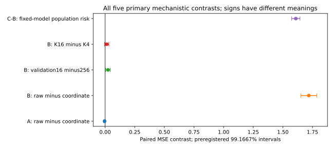
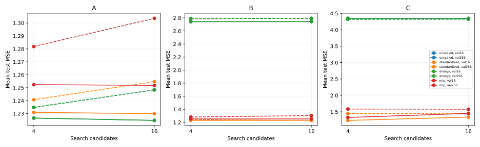
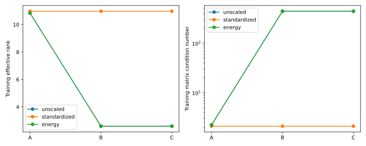
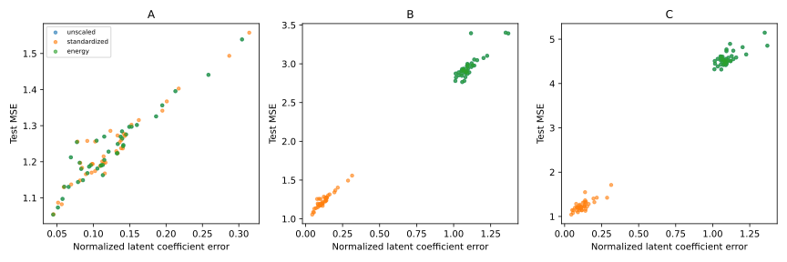

# M23 — representation geometry and validation selection

**Engineering PASS.** Scientific decisions below use the preregistered thresholds; no improvement is assumed.


The bounded scientific conclusion is that **coordinate regularization geometry can
cause a large predictive difference when informative features have small units**, and
covariate shift can magnify the risk of the same fitted model. In B, fixed unscaled
ridge has mean test MSE **2.955935**, versus **1.236434** for fixed standardized ridge:
paired reduction **1.719501**, simultaneous interval **[1.652497, 1.786505]**, 40/40
positive. Fixed normalized latent coefficient error drops from **1.100675** to
**0.125137**; recovery and prediction are separately measured, not interchangeable.
A meets the prespecified equivalence margin: gain **-0.004493**, interval
**[-0.010875, 0.001890]**, wholly within ±0.05.

Larger validation sets reduce B coordinate-ridge MSE by **0.024801** at K16, with
interval **[0.005606, 0.043997]**. This is a modest positive contrast but **does not meet
the preregistered 0.05 meaningful-effect gate**. Population oracle regret falls from
0.030983 to 0.005769 and selection optimism from 0.151335 to 0.023226. These diagnostics
support finite-validation sensitivity, without promoting it into the stronger primary
claim. K16 minus K4 at validation16 is **0.013990**, interval **[-0.003905, 0.031885]**:
meaningful multiplicity harm is not established.

With identical B/C trained coefficients, the fixed unscaled predictor's analytic
population risk increases **1.609242**, interval **[1.573948, 1.644535]**, solely under
the declared covariance intervention. Its latent coefficient error is unchanged.
This is not a new fit, a change of conditional regression coefficients, or proof that
all predictors respond similarly to shift.

**No qualified meaningful gain over the strongest fixed comparator was established.**
The preregistered selected-coordinate candidate in B has test MSE **1.229904**, versus
**1.236434** for fixed standardized ridge. Gain **0.006529**, conservative interval
**[-0.005401, 0.018460]**, fails the 0.10 gate. It also beats fixed MLP by only 0.022426,
interval [0.006220, 0.038633], below that same gate. Strong gains against a weak unscaled
prior do not establish gains over a strong fixed baseline. The other predeclared
conditions remain fully reported descriptively; none is promoted as a test-chosen
replacement winner.

## Primary decisions

| Hypothesis | Paired mean | Simultaneous interval | Decision |
| --- | ---: | --- | --- |
| H_A | -0.004492759 | [-0.010875366, 0.001889848] | supported equivalence |
| H_B | 1.719501274 | [1.652497107, 1.786505441] | supported geometry benefit |
| H_V | 0.024801262 | [0.005605646, 0.043996879] | inconclusive meaningful direction |
| H_K | 0.013990188 | [-0.003904914, 0.031885290] | inconclusive meaningful direction |
| H_S | 1.609241687 | [1.573948408, 1.644534967] | identified covariance-risk effect |

**Strong fixed comparator decision:** meaningful gain over strongest fixed comparator not established.

| B selected coordinate vs fixed comparator | Mean gain | Conservative interval |
| --- | ---: | --- |
| unscaled | 1.726030770 | [1.646610273, 1.805451267] |
| standardized | 0.006529496 | [-0.005400564, 0.018459555] |
| energy | 1.726030770 | [1.646610273, 1.805451267] |
| mlp | 0.022426424 | [0.006220228, 0.038632619] |

Positive H_A/H_B gain is raw minus standardized MSE; H_V is small minus large validation MSE; H_K is large minus small candidate-set MSE. H_S is analytic covariance-risk change with identical fitted state. Intervals use 40 paired independent simulation units and the preregistered multiplicity correction. HG requires a lower bound above 0.10 against every fixed baseline, including standardized ridge itself.

## All validation-selection conditions

| Scenario | Method | Validation | K | Mean test MSE | Wins / losses / ties vs fixed | Mean population oracle regret |
| --- | --- | ---: | ---: | ---: | --- | ---: |
| A | unscaled | 16 | 4 | 1.234794 | 5 / 7 / 28 | 0.010030 |
| A | unscaled | 16 | 16 | 1.248326 | 10 / 20 / 10 | 0.030249 |
| A | unscaled | 256 | 4 | 1.226523 | 7 / 2 / 31 | 0.001873 |
| A | unscaled | 256 | 16 | 1.224733 | 17 / 7 / 16 | 0.005985 |
| A | standardized | 16 | 4 | 1.240716 | 6 / 7 / 27 | 0.011194 |
| A | standardized | 16 | 16 | 1.254706 | 11 / 23 / 6 | 0.030983 |
| A | standardized | 256 | 4 | 1.230942 | 8 / 1 / 31 | 0.001437 |
| A | standardized | 256 | 16 | 1.229904 | 14 / 8 / 18 | 0.005769 |
| A | energy | 16 | 4 | 1.234794 | 5 / 7 / 28 | 0.010030 |
| A | energy | 16 | 16 | 1.248326 | 10 / 20 / 10 | 0.030249 |
| A | energy | 256 | 4 | 1.226523 | 7 / 2 / 31 | 0.001873 |
| A | energy | 256 | 16 | 1.224733 | 17 / 7 / 16 | 0.005985 |
| A | mlp | 16 | 4 | 1.281835 | 0 / 10 / 30 | not defined |
| A | mlp | 16 | 16 | 1.303621 | 4 / 23 / 13 | not defined |
| A | mlp | 256 | 4 | 1.252331 | 0 / 0 / 40 | not defined |
| A | mlp | 256 | 16 | 1.251837 | 10 / 10 / 20 | not defined |
| B | unscaled | 16 | 4 | 2.788206 | 36 / 3 / 1 | 0.064884 |
| B | unscaled | 16 | 16 | 2.793445 | 36 / 4 / 0 | 0.069986 |
| B | unscaled | 256 | 4 | 2.742422 | 39 / 1 / 0 | 0.020997 |
| B | unscaled | 256 | 16 | 2.743297 | 39 / 1 / 0 | 0.022044 |
| B | standardized | 16 | 4 | 1.240716 | 6 / 7 / 27 | 0.011194 |
| B | standardized | 16 | 16 | 1.254706 | 11 / 23 / 6 | 0.030983 |
| B | standardized | 256 | 4 | 1.230942 | 8 / 1 / 31 | 0.001437 |
| B | standardized | 256 | 16 | 1.229904 | 14 / 8 / 18 | 0.005769 |
| B | energy | 16 | 4 | 2.788206 | 36 / 3 / 1 | 0.064884 |
| B | energy | 16 | 16 | 2.793445 | 36 / 4 / 0 | 0.069986 |
| B | energy | 256 | 4 | 2.742422 | 39 / 1 / 0 | 0.020997 |
| B | energy | 256 | 16 | 2.743297 | 39 / 1 / 0 | 0.022044 |
| B | mlp | 16 | 4 | 1.281835 | 0 / 10 / 30 | not defined |
| B | mlp | 16 | 16 | 1.303621 | 4 / 23 / 13 | not defined |
| B | mlp | 256 | 4 | 1.252331 | 0 / 0 / 40 | not defined |
| B | mlp | 256 | 16 | 1.251837 | 10 / 10 / 20 | not defined |
| C | unscaled | 16 | 4 | 4.320475 | 33 / 3 / 4 | 0.300249 |
| C | unscaled | 16 | 16 | 4.323357 | 35 / 5 / 0 | 0.303324 |
| C | unscaled | 256 | 4 | 4.348390 | 37 / 1 / 2 | 0.328623 |
| C | unscaled | 256 | 16 | 4.346523 | 39 / 1 / 0 | 0.326648 |
| C | standardized | 16 | 4 | 1.443771 | 5 / 10 / 25 | 0.216349 |
| C | standardized | 16 | 16 | 1.455167 | 8 / 24 / 8 | 0.232939 |
| C | standardized | 256 | 4 | 1.238608 | 6 / 3 / 31 | 0.014448 |
| C | standardized | 256 | 16 | 1.338106 | 7 / 27 / 6 | 0.117966 |
| C | energy | 16 | 4 | 4.320475 | 33 / 3 / 4 | 0.300249 |
| C | energy | 16 | 16 | 4.323357 | 35 / 5 / 0 | 0.303324 |
| C | energy | 256 | 4 | 4.348390 | 37 / 1 / 2 | 0.328623 |
| C | energy | 256 | 16 | 4.346523 | 39 / 1 / 0 | 0.326648 |
| C | mlp | 16 | 4 | 1.584384 | 2 / 8 / 30 | not defined |
| C | mlp | 16 | 16 | 1.579254 | 2 / 29 / 9 | not defined |
| C | mlp | 256 | 4 | 1.328888 | 0 / 2 / 38 | not defined |
| C | mlp | 256 | 16 | 1.451608 | 3 / 27 / 10 | not defined |

Wilson intervals for win/loss rates, 95% paired effects, selected penalties, optimism and gaps are in results.json and selections.csv. Every candidate and seed is retained in candidates.csv. Oracle quantities were computed after selection and never chose a model.

## Controls and diagnostics

Maximum scalar/diagonal prediction-equivalence absolute error: 3.602673714908633e-14, tested with rtol=1e-8/atol=1e-9.
Label-permutation A/unscaled mean Spearman: 0.024496077; descriptive 95% interval [-0.03929703965726762, 0.08828919435093467].

Every fitted candidate and permutation control was independently refitted with exact state equality. A/B retain identical latent task/labels; B/C share exactly the same training states. Training-only preprocessing and evaluation-label noninterference pass. Redundant fourfold search copies do not change selections. All seed hashes, geometry diagnostics, controls and source/environment identity are recorded.






## Interpretation limits

Scaling geometry is identified by paired changes of feature units and exact diagonal-penalty identities, not a change of underlying labels. Global energy normalization with the matched penalty is only a scalar reparameterization. The H_A equivalence criterion is distinct from failing to reject a difference. Coefficient recovery is a separate secondary diagnostic from test MSE; covariance weights coefficient errors differently.

Validation size and search-grid density are independently varied. Larger candidate sets also improve available oracle opportunity; H_K is not a pure test of independent multiple comparisons. Selection optimism and population oracle regret distinguish finite validation noise from that opportunity. The MLP has the same candidate counts but not equal capacity, compute cost or effective regularization geometry. It is secondary, with no convergence or fairness-by-wall-time claim.

C is covariate shift with unchanged conditional coefficients/noise. decomposition.csv separately freezes the selected B model on C test data and then changes the validation-selected configuration on that same C test set. The terms sum to the total paired difference; they are not independent interventions on every property.

These controlled Gaussian tasks establish only their own numerical mechanisms. They do not explain M17/M19 biological results, validate external protein generalization, establish optimal model quality, or authorize biological follow-up. Synthetic seeds are independent simulation units here; historical protein-family seeds were not independent families. No test-informed grid, scenario, tolerance or threshold revision occurred.

## Reproduction and preservation

Run from the registered checkout with development dependencies and matplotlib. Use a fresh runs/m23 output path; overwrites are refused.

```sh
pytest -q tests/test_m23_geometry.py
ruff check .
ruff format --check .
python scripts/verify_m23.py --local-refs
python scripts/run_m23.py --output runs/m23/reproduction
python scripts/verify_m23.py --result runs/m23/reproduction/results.json
python scripts/report_m23.py --source runs/m23/reproduction --output runs/m23/reproduction/plots
```

The protocol/config were committed before implementation; implementation freeze and execution metadata are in implementation-freeze.json and verification.json. All historical research code/evidence remains intact. CI_ADDENDUM.md documents the only two CI plumbing overlays, with original bytes archived and verified explicitly. No old report, result, threshold, trainer or frozen manifest was rewritten. Existing M22 numerical/state helpers are reused. No biological data, optimization, release or merge.

## Execution audit

Registration `d6f5266` preceded any M23 implementation/test execution. The explicit
CI-only overlay addendum `eabaef0` preceded implementation. Frozen implementation
`e0e1533` generated the complete registered run with no failed/replaced seed and no
post-execution fitting-code, grid or threshold amendment. Supplemental identities.json
was generated from the same frozen generators without fitting/selection; its training
hashes match every recorded unit. It records every split and the 120-epoch order/RNG
identities. Recreate a schedule using geometry_study.rng(seed,300), 120 permutations of
64 rows and consecutive chunks of 32; split hashes use the existing M22 array_digest
on geometry_study.generate(seed, config) arrays.

Raw evidence has 7,680 candidate rows, 1,920 selection rows and 640 paired shift
decompositions, all checksum/count verified. There are 5,120 distinct fitted candidate
states (C reuses B) and independent refits of every one, plus 640 fixed label-permutation
fits/refits. The MLP accounts for 2,720 of these fitting calls including controls and
replays; no new settings were searched. There are 40 independent units, not 10,880
independent scientific replications. Nine new focused tests and 86 combined synthetic
tests pass. SVG files are parsed as XML. Existing release packaging integrity passes;
applicable CI runs are recorded on the draft PR. No throughput, GPU or cold-acquisition
benchmark is claimed. Original M0–M22 evidence and all 39 pre-existing local branch
refs, including the local interrupted-study archive, are preserved. Only the two
predeclared CI plumbing paths differ in place; their originals are preserved and
hash-verified. The original standalone M22.5 checker should be invoked through the
M23 adapter on this overlay tree, not mistaken for accepting modified live router bytes.
