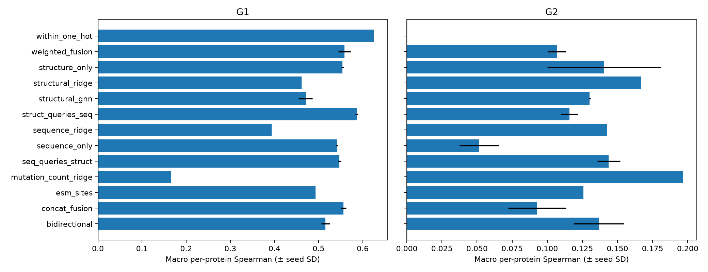
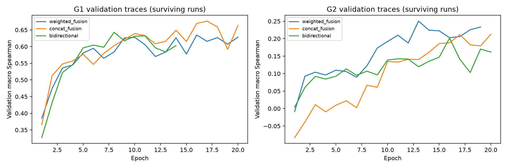

# M5 local benchmark

Exact M4 structure-matched IDs; higher Spearman is better. Two neural seeds; SD is population SD across seeds, not a confidence interval. Classical M4 comparators have one fit. G1 and G2 use different primary test populations.

| Model | G1 macro ± SD | G2 macro ± SD |
|---|---:|---:|
| bidirectional | 0.5156 ± 0.0096 | 0.1367 ± 0.0179 |
| concat_fusion | 0.5563 ± 0.0060 | 0.0928 ± 0.0206 |
| esm_sites | 0.4932 ± 0.0000 | 0.1258 ± 0.0000 |
| mutation_count_ridge | 0.1663 ± 0.0000 | 0.1965 ± 0.0000 |
| seq_queries_struct | 0.5471 ± 0.0029 | 0.1437 ± 0.0081 |
| sequence_only | 0.5414 ± 0.0021 | 0.0516 ± 0.0141 |
| sequence_ridge | 0.3938 ± 0.0000 | 0.1428 ± 0.0000 |
| struct_queries_seq | 0.5861 ± 0.0028 | 0.1158 ± 0.0060 |
| structural_gnn | 0.4704 ± 0.0160 | 0.1300 ± 0.0007 |
| structural_ridge | 0.4612 ± 0.0000 | 0.1669 ± 0.0000 |
| structure_only | 0.5542 ± 0.0028 | 0.1404 ± 0.0404 |
| weighted_fusion | 0.5586 ± 0.0141 | 0.1068 ± 0.0064 |
| within_one_hot | 0.6254 ± 0.0000 | — |

## Per-protein results (mean of seeds)

| Protocol | Model | Amylase | GB1 | NucB |
|---|---|---:|---:|---:|
| G1 | bidirectional | 0.5841 | 0.6848 | 0.2778 |
| G1 | concat_fusion | 0.5405 | 0.7714 | 0.3571 |
| G1 | esm_sites | 0.3318 | 0.7538 | 0.3940 |
| G1 | mutation_count_ridge | 0.2730 | 0.2047 | 0.0212 |
| G1 | seq_queries_struct | 0.5805 | 0.7419 | 0.3188 |
| G1 | sequence_only | 0.5101 | 0.7609 | 0.3533 |
| G1 | sequence_ridge | 0.4375 | 0.5337 | 0.2103 |
| G1 | struct_queries_seq | 0.5758 | 0.7816 | 0.4007 |
| G1 | structural_gnn | 0.5855 | 0.6466 | 0.1792 |
| G1 | structural_ridge | 0.5681 | 0.5459 | 0.2694 |
| G1 | structure_only | 0.5597 | 0.7335 | 0.3695 |
| G1 | weighted_fusion | 0.5741 | 0.7417 | 0.3601 |
| G1 | within_one_hot | 0.5800 | 0.7641 | 0.5321 |
| G2 | bidirectional | 0.2514 | 0.1056 | 0.0532 |
| G2 | concat_fusion | 0.2292 | 0.0415 | 0.0076 |
| G2 | esm_sites | 0.1558 | 0.2064 | 0.0151 |
| G2 | mutation_count_ridge | 0.3628 | 0.1910 | 0.0358 |
| G2 | seq_queries_struct | 0.3246 | 0.1474 | -0.0408 |
| G2 | sequence_only | 0.1651 | 0.0715 | -0.0817 |
| G2 | sequence_ridge | 0.2043 | 0.1732 | 0.0508 |
| G2 | struct_queries_seq | 0.2930 | 0.0767 | -0.0222 |
| G2 | structural_gnn | 0.2415 | 0.1812 | -0.0326 |
| G2 | structural_ridge | 0.3458 | 0.1876 | -0.0326 |
| G2 | structure_only | 0.2290 | 0.1838 | 0.0086 |
| G2 | weighted_fusion | 0.2281 | 0.1057 | -0.0135 |

## Compute and selection

| Model | Parameters | Total fit seconds | Selected epoch range |
|---|---:|---:|---:|
| bidirectional | 14113 | 88.69 | 3–17 |
| concat_fusion | 12001 | 80.46 | 1–20 |
| seq_queries_struct | 13057 | 95.15 | 3–18 |
| sequence_only | 8545 | 26.21 | 1–20 |
| struct_queries_seq | 13057 | 70.14 | 1–16 |
| structure_only | 3505 | 41.08 | 1–17 |
| weighted_fusion | 11234 | 60.68 | 1–17 |

See `interpretation.md` for failure analysis, coverage/confidence limitations and reproduction evidence. `summary.json` includes G1 training-CDF RMSE per assay; G2 RMSE is intentionally undefined. `mutation_burden.csv` retains stratum sizes and undefined correlations rather than pooling unlike assays.
