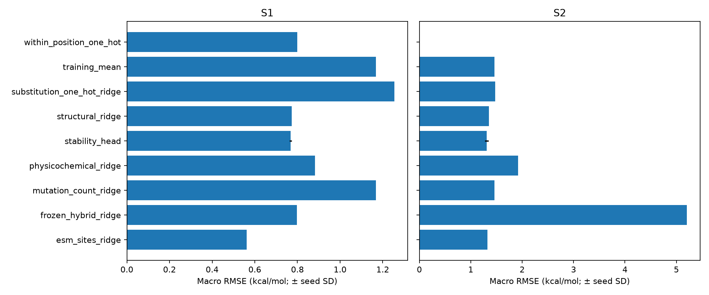
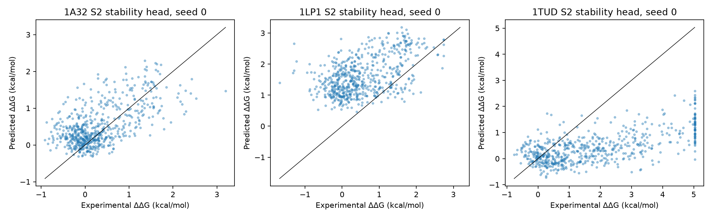
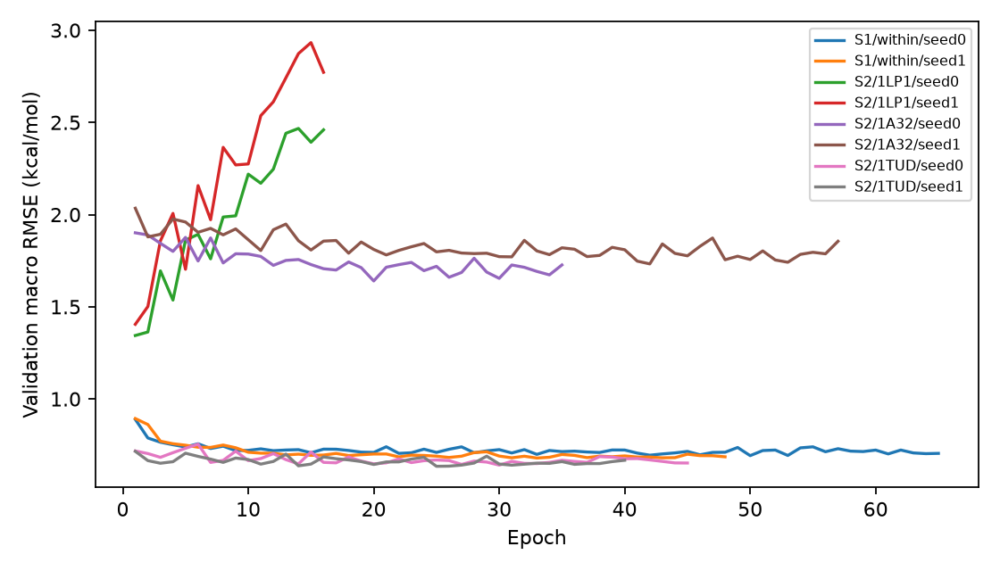

# M6: experimental stability benchmark

Native folding ΔΔG in kcal/mol, positive destabilization. Same test IDs for every model within each protocol. Mean ± population seed SD; two head seeds, one fit for classical baselines. No cross-assay target pooling or rank normalization.

| Model | S1 RMSE | S2 RMSE | S1 Spearman | S2 Spearman |
|---|---:|---:|---:|---:|
| esm_sites_ridge | 0.5612 ± 0.0000 | 1.3264 ± 0.0000 | 0.8416 ± 0.0000 | 0.4438 ± 0.0000 |
| frozen_hybrid_ridge | 0.7970 ± 0.0000 | 5.2021 ± 0.0000 | 0.6282 ± 0.0000 | 0.4326 ± 0.0000 |
| mutation_count_ridge | 1.1680 ± 0.0000 | 1.4625 ± 0.0000 | 0.0000 ± 0.0000 | 0.0000 ± 0.0000 |
| physicochemical_ridge | 0.8830 ± 0.0000 | 1.9230 ± 0.0000 | 0.5669 ± 0.0000 | 0.3723 ± 0.0000 |
| stability_head | 0.7686 ± 0.0052 | 1.3098 ± 0.0346 | 0.6695 ± 0.0001 | 0.4902 ± 0.0064 |
| structural_ridge | 0.7728 ± 0.0000 | 1.3503 ± 0.0000 | 0.7007 ± 0.0000 | 0.5491 ± 0.0000 |
| substitution_one_hot_ridge | 1.2541 ± 0.0000 | 1.4735 ± 0.0000 | 0.2692 ± 0.0000 | 0.3283 ± 0.0000 |
| training_mean | 1.1680 ± 0.0000 | 1.4625 ± 0.0000 | 0.0000 ± 0.0000 | 0.0000 ± 0.0000 |
| within_position_one_hot | 0.7998 ± 0.0000 | — | 0.6996 ± 0.0000 | — |

## Per-protein stability head (two-seed means)

| Protocol | Protein | Spearman | Pearson | MAE kcal/mol | RMSE kcal/mol |
|---|---|---:|---:|---:|---:|
| S1 | 1A32 | 0.6621 | 0.7342 | 0.3623 | 0.4722 |
| S1 | 1LP1 | 0.6458 | 0.6099 | 0.4684 | 0.6185 |
| S1 | 1TUD | 0.7006 | 0.7109 | 0.9426 | 1.2152 |
| S2 | 1A32 | 0.4776 | 0.5879 | 0.4634 | 0.5859 |
| S2 | 1LP1 | 0.4402 | 0.4812 | 1.2272 | 1.3897 |
| S2 | 1TUD | 0.5530 | 0.6390 | 1.5222 | 1.9537 |

See `interpretation.md` for failure analysis, dataset restrictions and reproducibility. `per_protein.csv` retains every model/seed's four metrics and observed/predicted ranges. `summary.json` also reports S2 restricted to S1 test IDs. Exact reproduction and transfer-checkpoint recovery are documented in `docs/m6_protocol.md`.
