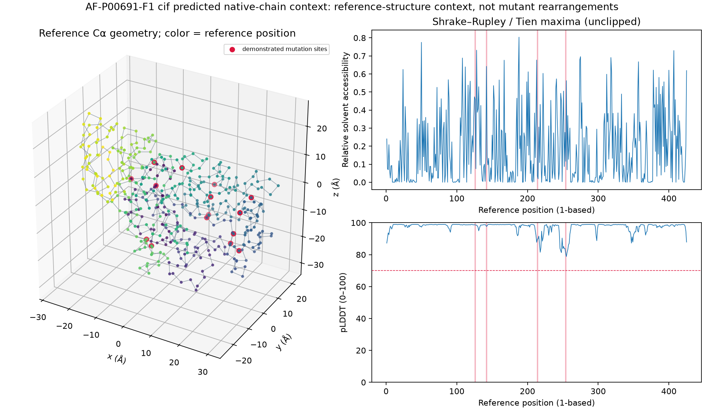

# Structural mapping: AF-P00691-F1 cif predicted native-chain context

All variant features are reference-structure context. No mutant coordinates were predicted.

Selected author chain: A; coordinate coverage: 1.000000.
Aligned identity: 0.990588; exact compatible Cα positions: 421.
Missing/unobserved reference positions: [].
Reference/construct differences (explicitly reviewed): ['P126Q', 'S142L', 'V214A', 'V254S'].
Structure insertions/tags (polymer positions): [1, 2, 3, 4, 5, 6, 7, 8, 9, 10, 11, 12, 13, 14, 15, 16, 17, 18, 19, 20, 21, 22, 23, 24, 25, 26, 27, 28, 29, 30, 31, 32, 33, 34, 35, 36, 37, 38, 39, 40, 41, 467, 468, 469, 470, 471, 472, 473, 474, 475, 476, 477, 478, 479, 480, 481, 482, 483, 484, 485, 486, 487, 488, 489, 490, 491, 492, 493, 494, 495, 496, 497, 498, 499, 500, 501, 502, 503, 504, 505, 506, 507, 508, 509, 510, 511, 512, 513, 514, 515, 516, 517, 518, 519, 520, 521, 522, 523, 524, 525, 526, 527, 528, 529, 530, 531, 532, 533, 534, 535, 536, 537, 538, 539, 540, 541, 542, 543, 544, 545, 546, 547, 548, 549, 550, 551, 552, 553, 554, 555, 556, 557, 558, 559, 560, 561, 562, 563, 564, 565, 566, 567, 568, 569, 570, 571, 572, 573, 574, 575, 576, 577, 578, 579, 580, 581, 582, 583, 584, 585, 586, 587, 588, 589, 590, 591, 592, 593, 594, 595, 596, 597, 598, 599, 600, 601, 602, 603, 604, 605, 606, 607, 608, 609, 610, 611, 612, 613, 614, 615, 616, 617, 618, 619, 620, 621, 622, 623, 624, 625, 626, 627, 628, 629, 630, 631, 632, 633, 634, 635, 636, 637, 638, 639, 640, 641, 642, 643, 644, 645, 646, 647, 648, 649, 650, 651, 652, 653, 654, 655, 656, 657, 658, 659].
Chain break diagnostics: [].

Contacts: 2235 undirected edges; 424 peptide backbone links; 1388 nonlocal Cα contacts.
ASA: {'algorithm': 'Biopython Shrake-Rupley', 'probe_radius_a': 1.4, 'sphere_points': 960, 'environment': 'entire selected deposited model, occupied heavy atoms including ligands/other chains; no waters/H/D; no symmetry mates', 'rsa_table': 'Tien et al. 2013 theoretical maxima (Wilke), doi:10.1371/journal.pone.0080635', 'max_asa_a2': {'A': 129, 'C': 167, 'D': 193, 'E': 223, 'F': 240, 'G': 104, 'H': 224, 'I': 197, 'K': 236, 'L': 201, 'M': 224, 'N': 195, 'P': 159, 'Q': 225, 'R': 274, 'S': 155, 'T': 172, 'V': 174, 'W': 285, 'Y': 263}, 'rsa_clipped': False, 'secondary_structure': {'status': 'unavailable', 'reason': 'mkdssp/dssp not installed; no SS invented'}}; mean RSA over identity-compatible Cα sites: 0.1794812886268974.
Confidence semantics: **alphafold_plddt**. Experimental B-factors are not pLDDT.

| Variant | Mutation set | Usable sites | Unmapped/mismatched sites | Mean site RSA | Mean pair distance (Å) |
|---|---|---:|---:|---:|---:|
| reference | reference | 0 | 0 | None | None |
| synthetic-multi | T10A;T200A | 2 | 0 | 0.10115844629638612 | 22.214470659566526 |
| synthetic-N-terminus | L1A | 1 | 0 | 0.240093769879709 | None |
| synthetic-construct-mismatch | P126A | 0 | 1 | None | None |
| FLIP2-row-1 | T10V;T103P;I209W | 3 | 0 | 0.0016446363120361958 | 22.520977738970927 |
| FLIP2-row-2 | A98V | 1 | 0 | 0.0 | None |
| FLIP2-row-3 | R296H;P307Q;G326N | 3 | 0 | 0.039122646581455534 | 18.682641132050815 |
| FLIP2-row-4 | R133D;R164K | 2 | 0 | 0.18880399759083982 | 30.818534619633365 |
| FLIP2-row-5 | W130Y;L141W;G143S;Y252W | 4 | 0 | 0.1938288022667422 | 18.56485708767968 |

## Limits and interpretation

Sequence neighbors are nearby FASTA indices. Spatial neighbors can be distant in sequence but within the Cα distance cutoff after folding. A sequence-adjacent pair is marked backbone only with adjacent polymer indices, no TER break and a C–N distance ≤1.8 Å. Local contact density is spatial degree divided by a sphere volume of radius cutoff (residues/ų). Missing loops are never bridged as peptide bonds. Contacts are single-chain and omit unmapped insertions; SASA includes occupied heavy atoms of the selected deposited model, excluding water/H/D, including ligands/other chains and no crystal symmetry expansion. Missing atoms can inflate SASA.

Author residue numbers need not start at one, can be negative or include insertion codes, and differ from polymer and assay reference indices. Tags, missing coordinates and engineered substitutions require explicit alignment; equally optimal alignments are rejected.

pLDDT describes local prediction confidence. Low values may reflect disorder/flexibility or insufficient information, not a measured stability change. High pLDDT does not establish reliable relative domain placement; PAE is not analyzed here. Experimental B-factors depend on displacement, occupancy and refinement and are retained in Ų without pLDDT thresholds.

Mutation sites at mismatched or missing residues produce explicit null features/distances, not guessed mappings. Symmetric aggregation sorts mutation positions, averages available site features and tracks missing counts. Reference geometry says nothing about mutant relaxation, epistasis, activity or stability improvements. No predictive baseline is trained.

Coordinate source: https://alphafold.ebi.ac.uk/entry/P00691
License: AlphaFold DB CC-BY-4.0
Reference provenance: https://github.com/florisvdf/mutation-predictability/blob/main/data/AMY_BACSU/reference.fasta
See audit.json, residues.csv/json, contacts.csv, variants.csv/json and manifest.json for full evidence.
