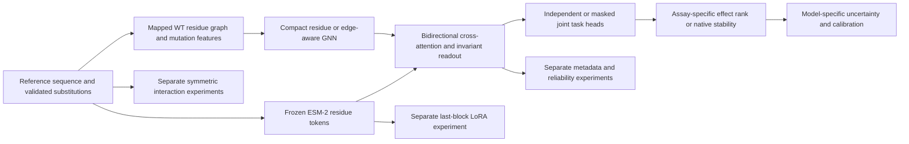
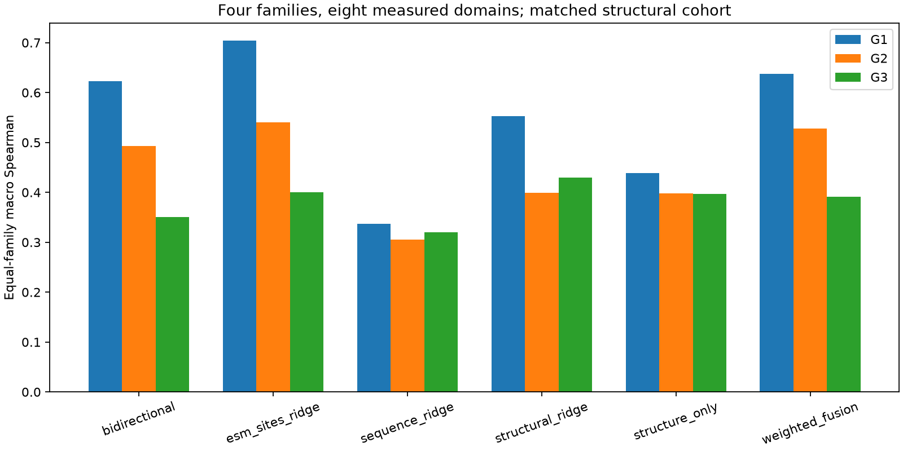
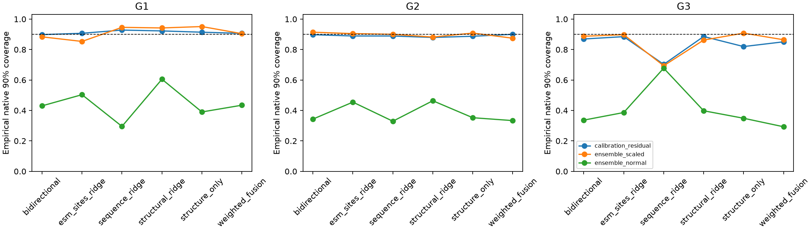

# M16: integration and research-release qualification

**Research verification: PARTIAL. Release qualification: FAIL / HOLD.**
No tag or release is authorized yet.
The integrated research code is consolidated; scientific validation is bounded by
its recorded cohorts. A project source license is deliberately left unresolved for final review, as requested.
Final human review is outstanding.
The [qualification matrix](../benchmarks/m16/QUALIFICATION.md) is the gate record;
[proposed notes](RELEASE_NOTES_PROPOSED.md) are not a published release.

## Commits and consolidation

The verified M0–M15 integrated main commit is
`7cc4dbbe9c47355d1afa46f6f46f502394e9e999`.
PRs #12, #14, #16, #18, #20, #22, #24, #26, #28 and #31 were merged oldest-first
with merge commits, retaining the original heads and all preregistration history.
For every PR, ten successful exact-head jobs were checked. Before each retarget,
the updated main tree was required to equal the PR's previously tested base tree;
thus the merge context introduced no untested content or conflict resolution.
Each head was guarded at merge time. All ten new merge commits independently passed
four offline Python jobs and one neural job: **50/50**, in addition to **100/100**
original-head jobs. No failed check was bypassed, force-push used or existing evidence
replaced. See [head snapshots](../benchmarks/m16/stack-before.json),
[merge SHAs](../benchmarks/m16/merges.json), and [exact CI jobs](../benchmarks/m16/main-ci.json).

The M16 qualification change is separate from that tested main snapshot; its own
head/check results must be reviewed before integration. Main is not silently updated
with an unreviewed report or model change. Version remains 0.1.0, not a newly released version.

## Objective and scientific hypotheses

The project asks whether local mutation-aware sequence and structure representations
improve experimentally measured effects, and whether improvements survive protein/family
shift. Individual milestone protocols/configurations were preserved, including
negative controls and validation-only selection. M16 is a retrospective integration
and reproduction audit, not a new preregistered test-set optimization campaign.

The hypotheses tested across the milestones were: structure/message passing improves
prediction beyond classical features; sequence–structure attention transfers better;
sharing task representations helps both tasks; metadata and confidence add information
beyond capacity/identity controls; explicit pairs recover measured epistasis; uncertainty
identifies errors and yields calibrated intervals; bounded LoRA improves frozen features.
Most advantages are local or unsupported under distribution shift. We did not change
hyperparameters to rescue negative held-out results during qualification.

## Architecture and supported pathways



This diagram describes interfaces and experiment families, not one trained checkpoint
containing every extension. M7 shares a frozen-PLM/trainable graph-attention representation
with separate continuous task heads and masked unpaired losses. M9/M10/M11 use the
explicitly documented frozen representations and separate heads. M15 adapts only ESM's
last block, not the multimodal model. Attaching M13 intervals or a reliability gate to
an unrelated checkpoint would require retraining/calibration and is not validated here.

Sequence encodings use pinned ESM-2 35M revision
`6fbf070e65b0b7291e7bbcd451118c216cff79d8`, residue dimension 480.
The mutation-site probe pools mutant and mutant-minus-WT tokens plus mutation count
(961 dimensions). Residue graphs use reference AA identity/properties, observed
geometry and missingness (34 static dimensions), mutation/substituted properties
(25 dynamic dimensions), spatial contacts and backbone links. Original edges have
three descriptors; M14 adds 29 edge channels including distance bases and validated
candidate interactions. Two message layers and symmetric sum/mean/global readout
support unordered multiple substitutions. Graph construction is separate from models.

M14 biochemical candidates are distance/atom-availability rules, not claims of complete
hydrogen-bond or energetic networks. M15 has rank-2 LoRA on final-block query/value,
3,840 adapter parameters and a 15,409-parameter head; its capacity control has the same
19,249 trainable parameters. Original 33,269,521 PLM parameters remain frozen.

## Experimental sources, provenance and units

| Cohort | Experimental measurements / selection | Structure / task contract | Licenses and evidence |
|---|---|---|---|
| M0–M3 | FLIP2 Alpha Amylase, 3,706 variants | 425-aa assay WT; official 2,403/601/702 roles; activity units | Assay MIT; [M0 provenance](../benchmarks/amylase/report.md), [M2](m2_protocol.md) |
| M4/M5/M7 function | 600 variants each Amylase, GB1, NucB | Heterogeneous function assays; assay-local training ranks; structure exclusions | Source-specific notices in [M4](m4_protocol.md); no common raw scale |
| M6/M7 stability | 600 measured singles each 1LP1/1A32/1TUD | 55/63/60-aa author constructs; native folding ΔΔG, positive destabilizing, kcal/mol | Tsuboyama/Zenodo CC BY 4.0; [M6](m6_protocol.md) |
| M9/M10 | PTEN, CYP2C9, VKOR1, 180 genotypes each, two endpoints | 1,080 activity/abundance observations, paired genotype roles; AlphaFold v6 | ProteinGym curation MIT, original study attribution, AF CC BY 4.0; [M9](m9_protocol.md) |
| M11 | Wu2016 GB1 measured counts; 2,648 selected variants | WT + 76 singles + 2,091 doubles + 360 triples + 120 quads; 64 probe-only lower-order genotypes | Original CC BY 4.0; FLIP derivative AFL 3.0; [notices](../benchmarks/m11/DATA_PROVENANCE.md) |
| M12–M15 family | Eight Tsuboyama domains, four Pfam families, 96 variants each | 438 singles / 330 doubles; construct-specific DMS ranking | ProteinGym MIT curation, original CC BY attribution; [sources/structures](../benchmarks/m12/DATA_PROVENANCE.md) |
| M13 native subset | 347 independently mapped primary-table singles from the M12 cohort | 421 native-ineligible variants remain masked, never zero-labelled | Same primary study, not independent experimental replicates; [crosswalk](../benchmarks/m13/DATA_PROVENANCE.md) |

M6 source unfolding ΔΔG is positive stabilizing and is explicitly negated for the
canonical folding convention. Censored/nonfinite/missing labels and incompatible
quantities such as ΔTm are not converted into thermodynamic targets. Predicted rank,
DMS_score, log-enrichment and kcal/mol remain different outputs. M11 log fitness is
ln(max(count-normalized enrichment, 0.01)); direct factorial epistasis requires four
actually measured uncensored terms. Predicted contrasts use four model predictions,
never observed lower-order test labels as oracle offsets.

The family set is SH3 (BBC1/MYO3), Chromo (CBX4/SR43C), Homeodomain (NKX31/PITX2),
WW (PIN1/SAV1), externally supported by Pfam 34.0 positional annotations. PDBs are
1TG0, 2BTT, 2K28, 2N88, 2L9R, 2L7M, 1I6C, 2YSB. PITX2 uses chain P; SAV1 uses
polymer span 7–49. BBC1/1TG0 is X-ray; seven others are NMR. The old BBC1 display-name
typo is documented by the preserved M12 erratum, not silently corrected in preregistration.
Family confidence descriptors remain conservatively unknown in the fixed comparisons.

ESM-2 and frozen ProteinMPNN are MIT-licensed upstream models/code. ProteinMPNN
revision `8907e6671bfbfc92303b5f79c4b5e6ce47cdef57`, checkpoint v_48_020,
is inverse-folding pretraining; only its frozen encoder is evaluated. wwPDB coordinates
are CC0, with deposition attribution. [M14 provenance](../benchmarks/m14/DATA_PROVENANCE.md)
and [M15 provenance](../benchmarks/m15/DATA_PROVENANCE.md) bind exact model/data hashes.
These source notices do not grant a missing license to ProteinMod's own code.



## Partitions, masks and leakage controls

- M0/M1 retain the official split, including 601 validation-flagged training rows
  removed from fitting. The 410 shared substitutions are disclosed, not repaired.
- M3 evaluates 2,296/577/700 structurally eligible variants, excluding 107/24/2.
  Comparators refit on identical training subsets; incompatible mutation sites are removed.
- G1 holds out variants within known proteins. M12 G1 is 512/128/128; G2 trains
  six proteins (576), validates one (96), tests one (96); G3 trains two families
  (384), validates one (192), tests one (192). Original genotype tags are retained.
- Family assignments, global/local similarity, aligned coverage and threshold
  clusters are audited. Unknown pretraining exposure prevents an unseen-pretraining,
  unseen-fold or broad-function claim. Four families are the effective family sample size.
- Native S1/S2 use M6's separate single-protein/held-out-protein design; S2 is
  600/600/600. They are not combined with rank targets for RMSE comparisons.
- M13 uses separate fit/selection/calibration/test roles, reserving calibration
  from prior training, while preserving original test genotypes. Those roles must
  not be substituted for M12/M14/M15 point-prediction protocols.
- All fitted target transforms/scalers/bootstrap samples use training only;
  validation chooses ridge alpha, LR/epoch, task weight and native heads as declared.
  Test labels only score. Mutation-order/node-order checks and label perturbation tests
  exercise the relevant data/learning interfaces. M7 masks unavailable task labels,
  balances per-task exposure and retains negative-transfer diagnostics.
- M9 keeps all measurements of a genotype in one role. Metadata are structured
  assay/endpoint/technology/context fields with unavailable/not-applicable masks;
  no invented temperature or pH. Shuffled/proxy/capacity controls remain visible.
- M10 distinguishes AlphaFold pLDDT from experimental B-factors and model predictive
  uncertainty; absent structure forces gate zero. M8 OOD predictions are never reused
  as validated thermodynamic inputs in later metadata/confidence experiments.
- M11 C2 excludes the chosen site pair from both training and validation backgrounds;
  probe-only labels never train. This tests interaction extrapolation, not protein transfer.

## Empirical comparison and failure analysis

The [README matched table](../README.md#matched-family-benchmark-highlights) compares
M12/M14/M15 on the same cohort/roles. It does not rank unrelated tasks against each other.
Per-protein, per-family, burden, nearest-neighbor and low-label slices are retained in
each archived report/CSV. The following highlights keep each original protocol/unit.

| Milestone | Observed result | Defensible interpretation |
|---|---|---|
| M0 | One-hot ρ 0.648837, RMSE 0.042845 | Strong inexpensive single-protein baseline; shared substitutions remain |
| M1 | Site probe ρ 0.634051, RMSE 0.039956 | Different ranking/error tradeoff; no superiority on every metric |
| M2 | Real PDB/mmCIF/AF alignment, contacts, RSA and typed confidence | Reference geometry/mapping validation, not a predicted mutation effect |
| M3 | Matched GNN ρ 0.654893 ± 0.023552 vs one-hot 0.645156; zero-message MLP 0.643132 | Small single-protein gain; seed SD is not evidence of population significance |
| M4 | Matched ESM G1/G2 ρ 0.49318/0.12577; structural ridge 0.46116/0.16690 | Strong transfer degradation; only three proteins |
| M5 | Bidirectional G1/G2 0.5156/0.1367; weighted 0.5586/0.1068 | Attention is not consistently better than simpler comparators |
| M6 | ESM S1/S2 RMSE 0.5612/1.3264; stability head 0.7686/1.3098 kcal/mol | Native head works locally, substantial OOD error remains |
| M7 | Independent/joint G2 function ρ 0.102592/0.098700; stability RMSE 1.247250/1.250014 | No consistent joint advantage; function negative transfer 4/9 equal-joint cases |
| M8 | Structural-source residual G2 ρ 0.166501 vs independent 0.102592 | OOD diagnostic, not validated thermodynamics or causal stability benefit |
| M9 | Structured/unconditioned G2 ρ 0.2008/0.2278; shuffled 0.2810 | Metadata conditioning benefit unsupported in this crossed-endpoint cohort |
| M10 | Combined/unconditioned G2 0.3082/0.3491; gate/zero-input gate 0.3365/0.3381 | Reliability confidence adds no robust benefit beyond controls |
| M11 | Additive C2 ρ 0.7064; ESM 0.6904; hybrid pairs 0.4535 | Explicit 3D interactions fail the withheld-pair test; ranking is not epistasis recovery |
| M12 | G3 structural ridge 0.4298, ESM 0.4008, bidirectional 0.3503 | Four-family transfer evidence favors simple features here |
| M13 | ESM G3 native 90% residual coverage 0.885, width 3.584 kcal/mol | Empirical shift diagnostic; finite family-level guarantee unavailable |
| M14 | Rich GNN G3 0.3799 vs original 0.4020; ProteinMPNN ridge 0.4147 | Rich edges/pretraining do not establish a general advantage |
| M15 | LoRA G3 0.3426, matched capacity 0.3317, frozen ridge 0.4008 | No robust LoRA advantage at the fixed budget; extra compute not justified by these results |

M12 G3 per-family bidirectional correlations are SH3 0.1692, Chromo 0.4478,
Homeodomain 0.2930, WW 0.4914; structural ridge 0.3591/0.5460/0.4331/0.3808.
The mean conceals substantial family variation. On common original G1 test genotypes,
ESM correlations are G1/G2/G3 0.7040/0.4140/0.2217; bidirectional
0.6225/0.4049/0.2315. Primary G1/G2/G3 test populations differ, so those common-test
slices are required to interpret generalization gaps without composition confounding.
Training-set sizes/family diversity still differ.

M7 validation-selected joint training worsens function in 6/9 protein-seed cases.
The independently rerun M8 audit confirms a severe physical extrapolation failure:
nearly constant missing-B-factor fractions have training scale about 6e-8, producing
large OOD offsets when experimental-vs-predicted descriptor availability changes.
Audited structural-source decomposition magnitudes exceed 1.37 million kcal/mol.
These are invalid thermodynamic predictions, preserved only as a negative control;
[full archived prediction ranges](../benchmarks/m16/m8-physical-ood.json) document the failure.
No clipping, reinterpretation or posthoc refit rescues them. Later M9/M10 metadata/
confidence paths do not consume those stability scalars.

M8 head gains must be read beside dummy/shuffle controls and the invalidity of
out-of-domain physical extrapolation. M9 conditions are mostly missing, so numerical
condition effects cannot be learned. M10 true-vs-shuffled differences change sign across
seeds. M11 3D does not beat zero-3D/shuffled distances. These are retained failures,
not omitted unsuccessful configurations.

M13 ensembles/bootstrap characterize model dispersion, not separately identifiable
aleatoric noise. pLDDT/B-factors are not prediction intervals. G3 has one calibration
family: valid 80/90% family-block quantiles are unbounded. Finite variant-residual
intervals/coverage and selective-risk/error-association plots are empirical only.
M13's manually reconstructed ridge scaling promotes float32 to float64; its own
training/prediction contract is preserved and replayed. M14/M15 restore StandardScaler's
float32 path when exact historical baseline equivalence is required. No historical
method or numerical output was silently rewritten to harmonize these distinct contracts.



## Reproduction

Use the pinned Python 3.12 environment in the README. The qualification run started
from a separate clean checkout of integrated main and a newly installed virtual
environment. Acquisition files, frozen activations, structural caches and historical
supervised weights were copied into ignored locations; this is **not a complete
network cold-start reproduction**. Fresh refits use distinct output/checkpoint identities (or separate canonical
workspaces for immutable M12/M13 output contracts),
while replay explicitly reloads old selected models. M2 reconstructs structures from
pinned cached coordinates. Offline flags disable incidental Hugging Face acquisition.

```sh
# In a clean checkout containing the M16 qualification scripts:
python scripts/qualify_m16.py tests
python scripts/qualify_m16.py replay
python scripts/qualify_m16.py refit
python scripts/qualify_m16.py compare
```

Each phase refuses an existing phase directory/output. M12/M13 run with byte-unchanged
canonical configs in fresh local clones; only acquisition/activation caches are copied,
with supervised checkpoint directories removed from the fresh copies before fitting.
Their result aliases under runs/m16-m12 and runs/m16-m13 point into those workspaces.
M10 rebuilds the current source-bound feature cache before fitting. Three initial
qualification attempts correctly stopped on these guards; original error logs and
corrected successful attempts are retained, with no relaxed provenance checks. Full fresh fits can take many minutes.
The runner records commands, exit codes, elapsed wall time and logs under runs/m16,
and checks all benchmark/config hashes after every command. Comparison rejects changed
headers, row IDs/order, missing rows and nonfinite differing numeric cells; tolerance
is absolute 1e-6 for every differing numeric field, with exact maximum differences
recorded. Exact identity is separately reported when observed. Runtime/environment,
manifest timestamps, Git ancestry and checkpoint ZIP bytes are not expected to match;
scientific predictions/selections/state tensors are the relevant comparisons.
The separate activation-regeneration audit can be repeated without replacing M1's cache:

```sh
python - <<'PYCONFIG'
import json, pathlib, tomllib
c = tomllib.loads(pathlib.Path('configs/amylase_m1.toml').read_text())
c['embedding']['cache'] = 'data/cache/m16-fresh-embeddings'
c['learning_curve']['output'] = 'runs/m16-fresh-m1'
pathlib.Path('runs').mkdir(exist_ok=True)
pathlib.Path('runs/m16-fresh-m1.json').write_text(json.dumps(c))
PYCONFIG
proteinmod extract --config runs/m16-fresh-m1.json --local-only
proteinmod run-m1 --config runs/m16-fresh-m1.json
```

Use new empty output/cache names for another independent extraction; the extraction
command verifies and reuses an existing cache. Compare resulting prediction columns
against benchmarks/amylase_m1/test_predictions.csv with the same stated tolerance.

For acquisition from empty caches, execute each linked milestone's explicit download/
prepare steps first; qualifications below state which paths were actually cold-run.
Do not describe checksum replay as retraining or cached extraction as a cold forward.

Replay phases check M7's selected refit and M8–M15 saved predictions, target contracts,
roles, masks and source/checkpoint hashes. M15 additionally compares raw full ESM with
cached-prefix adapted inference for all eight proteins. [M16 bounded inference](../scripts/infer_m16.py)
uses a real saved G3 LoRA checkpoint for BBC1 P56N and D45S;N47R, rejects unknown variants,
and returns no interval because the separate M13 calibration is ineligible.
Single-variant inference differs from historical batched inference by at most
4.17233e-7 (float32 batch rounding, below the stated 1e-6 tolerance); mutation-order
reversal is exact. Its two recorded predictions are 0.05477935075759888 and 0.5626708269119263,
respectively, in train-assay rank regression units. Mutation order is immaterial.

## Engineering, supply chain and release gates

Clean integrated main passed 187 tests; the M16 clean checkout passed 190. The
no-Torch core environment passed 121 tests with 16 optional skips. Ruff/format and
pip check passed. A wheel built successfully with all 57 source modules and no cache/
benchmark payload; its missing license notice confirms the source-license gate.
Frozen M5/M6 reference inference replayed 3,986 function and 4,140 native predictions
exactly, and the M8 source-failure decomposition was independently rerun.

The fresh measured install pins Python 3.12 numerical dependencies; core CI spans
Python 3.11–3.14. Neural CI runs the full suite on CPU Python 3.12, including release
checks, instead of a manually maintained subset. Ruff formatting is now explicit in CI.
No CUDA/MPS equivalence or every optional-version combination is claimed; M15 depends
on transformers 4.57.6's ESM-layer API, despite the wider optional dependency range.
A current clean install and pip dependency consistency check are not a full upstream
vulnerability audit. The bounded training runs are CPU float32/four-thread; historical
MPS frozen-token extraction remains part of the cached acquisition contract.

Preserve all existing benchmark/config bytes. No large model/array binaries, source
archives, tokens or environment caches belong in a release commit. Public evidence
contains relative paths; absolute historical environment paths are retained only in
immutable legacy records when present, not presented as portable reproduction commands.
License/credential/path/link scans and exact result records are in benchmarks/m16.

**Outstanding:** source-code license selection by the rights holder, complete empty-cache
external-data/model reacquisition and extraction parity, broad external/family validation,
a universal all-extension checkpoint (not scientifically evaluated), and final review.
A fresh M1 extraction recomputed all 3,706 425-residue variants plus WT from the
pinned checkpoint, without activation-cache reuse. The clean environment selected CPU;
the historical extraction selected MPS. Extraction took 177.000 s. Maximum differences
were mean 5.2452e-6, delta 3.8147e-6, site features 2.9027e-5. Refitted predictions differed
by at most 3.62634e-6 (mean/delta) and 2.14714e-6 (sites): **FAIL at the stated 1e-6
prediction tolerance**, without posthoc threshold relaxation. Native-data/ID matching
and classical baselines remained exact. Site rho changed 0.6340508299 → 0.6340530152;
RMSE 0.0399555521 → 0.0399555059. Mean-probe rho changed 0.4983788131 → 0.4983551737.
This is small device arithmetic drift, not bitwise cold-extraction reproducibility.
[Complete differences/metrics](../benchmarks/m16/fresh-m1-extraction.json) and
[fresh predictions](../benchmarks/m16/fresh-m1-predictions.csv) are retained separately.

Local/case link checks covered 62 Markdown documents with no unresolved targets.
Header-only external checks reached 48/49 citation URLs; Science DOI
10.1126/science.add2187 returned HTTP 403, so its accessibility remains unverified,
not declared a dead citation. See the link evidence. Security scanning found no tracked
weight/array/source archives or credential-pattern matches; this limited scan cannot
certify absence of every possible secret or upstream vulnerability.

These limitations do not invalidate bounded research experiments, but prevent a claim
that the full project is universally validated or ready for an unrestricted public release.
No tag/release was published. Further science should increase independent families,
verify pretraining overlap where possible, and test preregistered hypotheses on new data;
M16 does not tune again on these test sets.
