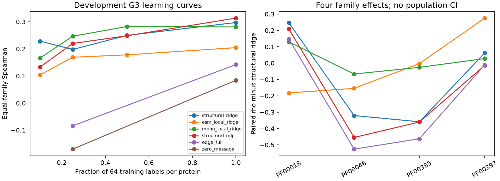

# M17: what explains the apparent structural-ridge advantage?

**This is a controlled development study, not independent confirmation.**
The independent-cohort gate is BLOCKED at label-level lineage. The scientific
release remains **FAIL/HOLD**. Source-code licensing is now MIT on the owner's
M16.1 commit; that resolves the source-license gate, not the scientific or third-party
distribution gates. No merge, tag or release is made.

The defensible finding is narrower than “structure beats language models.”
Under controlled label budgets the advantage varies by family, preprocessing and
message-passing control. A prespecified change from scaled to unscaled ESM ridge
reverses the equal-family average ordering. Physical edge topology does not show
a consistent advantage over a degree-preserving null. Neither result establishes
an independently replicated biological mechanism.

## Provenance and preregistration

Starting point: verified PR #34 head
`0908f90727bf36c0c5de7bdf7f591656efb27022` (MIT license added by owner), 12/12 exact-head
CI jobs successful. Main remains `7cc4dbbe9c47355d1afa46f6f46f502394e9e999`;
PR #32 is draft onto main, #34 draft onto #32. This work is stacked onto #34.
No historical score/report/configuration is rewritten.

[H1–H5 and decision criteria](../benchmarks/m17/PREREGISTRATION.md) were committed
at `5e0cfac` before any fitting. The exact outcome-free role manifest and independent
data gate were committed at `9172e9a`, also before fitting. Their checksums are in
[preregistration.json](../benchmarks/m17/preregistration.json). The eight M12
proteins, four Pfam families and 768 measured variants are DEVELOPMENT data because
they motivated the hypotheses. Five initialization/subsample seeds are not five
new families, assays, or independent replications.

### External-data qualification is a result, not a checkbox

The [eligibility matrix](../benchmarks/m17/ELIGIBILITY.md) preserves all decisions.
FLIP2 Hydro's README credits first-hand Escobedo2024 measurements under CC-BY4.
However, bounded reads of its 1.3GB primary archive revealed both new DiMSUM/CD/NMR
experiments and a 697,658,024-byte Tsuboyama2023 table. The FLIP target column was
not traceably linked to one source. Public FLIP main/release trees did not resolve
that preprocessing chain. Attribution to a different paper is insufficient evidence
of independent measurement generation. Nor is the mixed archive proof that the
FLIP labels were reused: the specific label lineage remains unresolved.

The initial preregistration phrase “this is NOT Tsuboyama” was too categorical.
The pre-fit eligibility commit explicitly corrected it at label level, leaving the
original plan intact as an audit trail. The candidate CSV was downloaded after the
initial registration and only sequence/set/validation columns were inspected. No
candidate target was used in a fit, selection, plot or performance estimate. No
external test outcomes were unblinded for prediction evaluation.

Other candidates were not silently substituted: new ProteinGym Tsuboyama assays
reuse the primary study; Nutschel2020 T50 is independent thermal inactivation, not
folding ΔΔG, with primary redistribution review and only one protein; Nisthal2019
GB1 is independent measurement generation but the protein already appeared in
M4/M11 and cannot be unseen-family confirmation. Functional DMS candidates require
a separate endpoint-shift question. See primary-source links in the eligibility
matrix. Frozen ESM/MPNN pretraining exposure remains unknown even if the eventual
experimental source is independent. A new, resolved lineage and precommitted
external split manifest are required before confirmation can proceed.

## Controlled design

H1/H3/H5 use four G3 folds: two families train, the next family validates, the
fourth tests. Each training protein contributes a nested 7/16/32/64 of its original
64 train variants (10/25/50/100%); total labels are 28/64/128/256 across four proteins.
Test is exactly the original 16 test variants per protein, two proteins/family:
32 test variants/fold. Validation uses original validation rows in the distinct
family. Every method sees the same IDs for a given fold/fraction/seed. No supervised
historical checkpoint is reused; frozen ESM residue caches and the pinned frozen
ProteinMPNN encoder are used as explicitly cached inputs.

H2 tests the exact same test variants across G1/G2/G3, with four training proteins
and 128 labels in every protocol. G1 has disjoint training rows of the test protein;
G2 has its family partner; G3 excludes the whole family. The validation family is
fixed and excluded across all three. These are new controlled protocols, not
numerically interchangeable with historical M12 G1/G2/G3. Training composition
necessarily changes with familiarity; this contrast does not isolate family identity
as a randomized causal variable.

The separate diversity experiment fixes TWO labeled proteins and 128 variants:
both proteins of one family versus one protein from each of two families. Both
narrow choices and all four diverse pairings are enumerated. It is not a comparison
of more labels or more proteins against fewer.

Primary statistic is within-protein Spearman, averaged equally within family and
then across the four families. Constant/undefined correlations are retained as
undefined; no-site controls cannot win by being dropped. Regression targets are
training-assay midrank percentiles only. Scalers fit training inputs only; validation
selects alpha/epoch; held-out labels never choose settings. No pooled assay-incompatible
RMSE or family-population bootstrap CI is reported.

The existing selection has 438 single and 330 double mutants, with no new outcome-based
filtering. Original adapter missing/nonfinite/duplicate and reference checks are retained.
No measured replicate-variance model or noise ceiling is available here; finite proxy
scores are not automatically uncensored native thermodynamic point measurements.
The stricter native-eligibility/censoring contract belongs to M13 only.
A repeated sequence-similarity audit retains global identity/coverage and ambiguous
alignments for all 28 WT pairs. Pfam-level exclusion is not proof that every evolutionary
relationship is absent; local short high-identity matches are not treated as whole-domain homology.

## Actual execution and reproducibility

**1,096 fresh fits; 34,304 held-out prediction rows; 55.224 s** measured wall time,
CPU/four threads, Python 3.12.15, PyTorch 2.14.1, NumPy 2.5.4, scikit-learn 1.9.1.
These are bounded tiny-data runs, not throughput claims for large proteins. Runtime
includes warm-cache feature loading and fresh ProteinMPNN encoding; excludes upstream
ESM extraction and independent data acquisition. Expensive features/weights remain
ignored caches. The manifest records versions, device, seed schedule and source hashes.

Every selected state was independently reloaded and all **1,096 models / 34,304
predictions replayed with maximum difference 0.0**. One prespecified full-label edge
GNN was independently refitted and also matched exactly. No full second training
sweep is claimed. Offline CI recomputes Spearman to 1e-12 for double-precision
statistic arithmetic; that is separate from neural CPU/MPS portability policy.

Ten probe models were evaluated at all four fractions/five seeds; original GNN,
rich edge GNN and three graph controls at 25% and 100%. All use fixed preregistered
grids/budgets. Neural 12-epoch/patience4 and MLP max_iter200 budgets differ; no equal
wall-time or universally optimized performance claim is made. MLP convergence
warnings and all validation candidates remain in the run records.

## H1: sample complexity is heterogeneous

| Train labels per protein | Structural ridge | Scaled local ESM ridge | Unscaled local ESM ridge | Structural MLP |
|---|---:|---:|---:|---:|
| 7 | 0.228309 | 0.103824 | 0.168015 | 0.132721 |
| 16 | 0.197721 | 0.168971 | 0.238971 | 0.219779 |
| 32 | 0.249779 | 0.177941 | 0.258824 | 0.248309 |
| 64 | 0.297059 | 0.204412 | 0.344853 | 0.313309 |

Values are equal-family averages after averaging five seeds, not independent-family
confidence bounds. Structural-minus-scaled-ESM advantage decreases by 0.031838 on
average from 10% to 100%, but only TWO of four family slopes agree. The preregistered
>=3/4 directional condition is not met: **H1 unresolved/not uniform**, rather than
supported by the average alone. The nonmonotonic structural curve is preserved.
At full labels train–validation rho gaps are 0.309692 structural ridge and 0.459631
scaled ESM ridge; they are diagnostics across different training/validation families,
not pure estimates of overfitting on an IID population.

## H2: familiarity helps on average; diversity alone does not

| Matched 128-label protocol | Structural ridge | Scaled local ESM ridge |
|---|---:|---:|
| G1 known protein | 0.396324 | 0.513603 |
| G2 held-out protein | 0.294118 | 0.234926 |
| G3 held-out family | 0.220221 | 0.200735 |

Family-specific changes differ: structural G3–G1 is −0.385294 SH3,
−0.189706 homeodomain, +0.170588 chromodomain and −0.300000 WW. The positive
chromodomain contrast rules out a universal monotonic shift rule. For scaled ESM,
all four G3–G1 contrasts are negative. Protein composition and endpoint variation
remain possible explanations alongside evolutionary shift.

At fixed two-protein/128-label budget, diverse-minus-narrow structural differences
are +0.080147, +0.147059, −0.006985 and −0.287500 (same family order). Mean −0.016820;
only 2/4 positive. ESM mean −0.052757, 0/4 positive. Thus **the preregistered diversity
benefit is not supported** in this small fixed-budget experiment. Adding family
coverage does not automatically outweigh losing within-family label concentration.

## H3/H4: distinguish computation from physical topology information

| Full-label G3 family | Structural ridge | Original GNN | Edge GNN | Zero message | Degree null |
|---|---:|---:|---:|---:|---:|
| SH3 PF00018 | −0.0294 | 0.1365 | 0.1794 | 0.1185 | 0.1947 |
| Homeodomain PF00046 | 0.5176 | −0.0047 | 0.0629 | −0.0085 | 0.0676 |
| Chromodomain PF00385 | 0.4103 | −0.0450 | 0.0500 | −0.0524 | 0.0582 |
| WW PF00397 | 0.2897 | 0.0350 | 0.2753 | 0.2785 | 0.2785 |

Full-label edge-minus-zero mean is +0.057868 with 3/4 families positive. But
edge-minus-degree-null mean is −0.007868, with **0/4 positive**. At 25% labels the
latter mean is +0.033015, driven by chromodomain; only 1/4 families is positive.
Neither fraction satisfies the registered physical-topology criterion. Chemistry
shuffle is worse at 25% (edge advantage +0.062206, 4/4 positive) but better at full
labels (edge advantage −0.023235, 0/4 positive). This reversal is evidence of instability,
not a reason to select one regime after observing outcomes.

The rich controls have 5,361 nominal parameters, identical node inputs and edge
feature widths. Zero-message disables 2,528 message parameters and 512 update-input
weights: only 2,321 scalar parameters are structurally reachable, before ReLU inactivity.
It is nominally matched, **not effectively capacity matched**. Structural MLP has
4,353 parameters, original GNN 3,473; they are explicit architectural/capacity
references, not exact equal-capacity interventions. All counts and runtime are reported.

The degree null preserves every node degree, edge count and reciprocal direction,
rejects self/duplicate edges, and uses 772–1,979 accepted double-edge swaps per
protein. It preserves global feature marginals while deliberately breaking endpoint/
distance/chemistry correspondence, including physical backbone edges. Reference
node descriptors and degree-related geometry remain available. Thus a strong null
can reflect those retained signals; it does not prove all structural information is
useless. It tests physical endpoint assignment beyond the preserved summaries.

A separate physical audit found **418 mapped nodes, 1,752 undirected contacts,
zero omitted/extra expected contact pairs, and no missing canonical heavy atoms**
in these eight constructs. All mapped backbone sites are complete. No mutation is
near a missing reference position because none is missing; the distance is null,
not an invented geometric value. pLDDT/B-factor semantics remain unknown where the
original contract says unknown. No confidence value is inferred from atom presence.
Candidate salt/hydrophobic/polar proximity is not a confirmed chemical bond; no
hydrogens/dynamics/solvent ensembles are inferred. Coverage loss therefore does not
explain this cohort's GNN disadvantage, but missing physics or insufficient labels
remain plausible. Correct contacts alone do not imply an informative learned model.

## H5: preprocessing can reverse the mean ordering

At full labels, unscaled-minus-scaled local ESM rho changes are +0.032353,
+0.135294, +0.248529 and +0.145588: mean **+0.140441, 4/4 positive**, meeting the
prespecified descriptive condition. Unscaled ESM mean 0.344853 exceeds structural
ridge 0.297059 by 0.047794, but only 2/4 families favor it. This is a specific
regularization/feature-scaling result, not an externally validated superiority claim.
Both treatments and the alpha grid were frozen before testing. Do not select a
universal deployment winner from this test comparison.

Global-minus-local ESM mean is −0.007721, 2/4 positive: no consistent pooling effect.
Local-minus-global frozen ProteinMPNN is +0.080872, 3/4 positive, but SH3 reverses by
−0.441176. The local/global readouts differ in dimension and information; this does
not isolate capacity. Structural MLP-minus-ridge is +0.016250, 2/4 positive, below
the registered criterion. WT-only control is constant within each protein and has
undefined rho in all four families, as expected. It is retained, not discarded to
improve an average. All per-seed/per-family differences are in the evidence tables.

## Uncertainty, calibration and low-label limits

Five-seed spread at low labels mixes initialization and which examples were sampled.
It is a training-sensitivity diagnostic, not calibrated posterior epistemic variance,
measured aleatoric noise or structure confidence. At 25% labels, mean within-protein
spread/error rho is 0.049685 structural ridge, 0.058134 scaled ESM and 0.031814 edge
GNN. At full labels deterministic ridges have zero spread and undefined association;
edge GNN association is −0.085797. Confidence-ranked selective error and fixed shuffled
controls are reported without test-fitted thresholds. Tied/zero spread is explicitly
uninformative. These results do not justify abstention guarantees on unseen families.

Native 80/90% coverage/width tables are a **recomputation of M13 evidence**, not
intervals for the new M17 predictors. Only native-eligible single mutants are used;
proxy DMS/rank outputs never acquire kcal/mol units. For M12 native-eligible structural
ridge, empirical variant-residual G3 family-macro coverage is 0.804859 / 0.892194;
mean family widths are 3.087300 / 4.110382 kcal/mol. These finite residual intervals
are descriptive under shift, not guaranteed family coverage. Correct family-block
quantiles with only **one calibration family** are unbounded at 80% and 90%; that
negative result is retained separately. M6 S2 structural-ridge variant-residual
coverage is only 0.522778 / 0.673333: native units alone do not ensure calibration.
Repeated-model observations are not counted as independent experimental samples.
The new M17 models have no qualified native ΔΔG intervals.

## Mechanistic synthesis and causal limits

The data support a limited working explanation: the apparent structural advantage
is a mixture of label budget, input scaling/regularization and which family is tested.
Message computation can help against a disabled-message control without evidence
that correct physical edges explain that gain. Complete reference contacts remove
one coverage-based explanation for these eight domains, while leaving insufficient
sample size, optimization, feature mismatch and omitted physical effects unresolved.
No attention map is used as a causal explanation. Reference geometry does not model
experimentally observed mutant rearrangements. There is no independent experimental
confirmation, no stable family-population CI, and no claim to explain a general law
of protein effects from four selected families.



## Reproduce and audit

Use the existing pinned M12/M14 environment and acquisition instructions. These
runs depend on existing raw/graph/ESM caches; they are not new cold-source reproduction.
The frozen ProteinMPNN encoder is executed, not fine-tuned. No new source/model
archive or binary weight is committed.

```sh
python -m pip install -r requirements-m3.txt -e '.[dev,esm,m3,structure]'
# Acquire/prepare M12 and pinned M14 encoder as their original protocols specify.
# Requires absent runs/m17 and data/cache/m17/weights; preserves previous attempts.
LOKY_MAX_CPU_COUNT=4 HF_HUB_OFFLINE=1 TRANSFORMERS_OFFLINE=1 \
  python -m proteinmod.mechanism_experiments
python scripts/audit_m17_atoms.py
MPLCONFIGDIR=/tmp/proteinmod-m17-mpl python scripts/report_m17.py
python scripts/interpret_m17.py
python scripts/verify_m17.py --states
ruff check .
ruff format --check .
pytest -q
python scripts/audit_m16.py
python scripts/verify_m16_1.py
python scripts/verify_m17.py
```

`--states` requires the local selected-weight cache; offline CI checks archived
predictions, exact IDs/labels and recomputed metrics without downloading models.
Archived weights are hash-bound by each run. The historical artifact audit checks
all existing milestone bytes and the new manifest. Exact role IDs, train-only target
handling, mutation burden, validation choices, warnings, gaps, runtimes and full
held-out predictions are retained in [benchmarks/m17](../benchmarks/m17/).
The [release matrix](../benchmarks/m17/QUALIFICATION.md),
[Neuralink ML evidence example and defense questions](M17_DEFENSE.md) distinguish
implemented evidence from unsupported claims. Independent confirmation, third-party
bundle clearance, complete cold reproduction, numerical portability limits and final
review remain gates. No tag is created.
